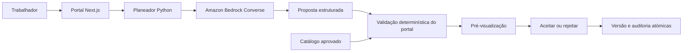
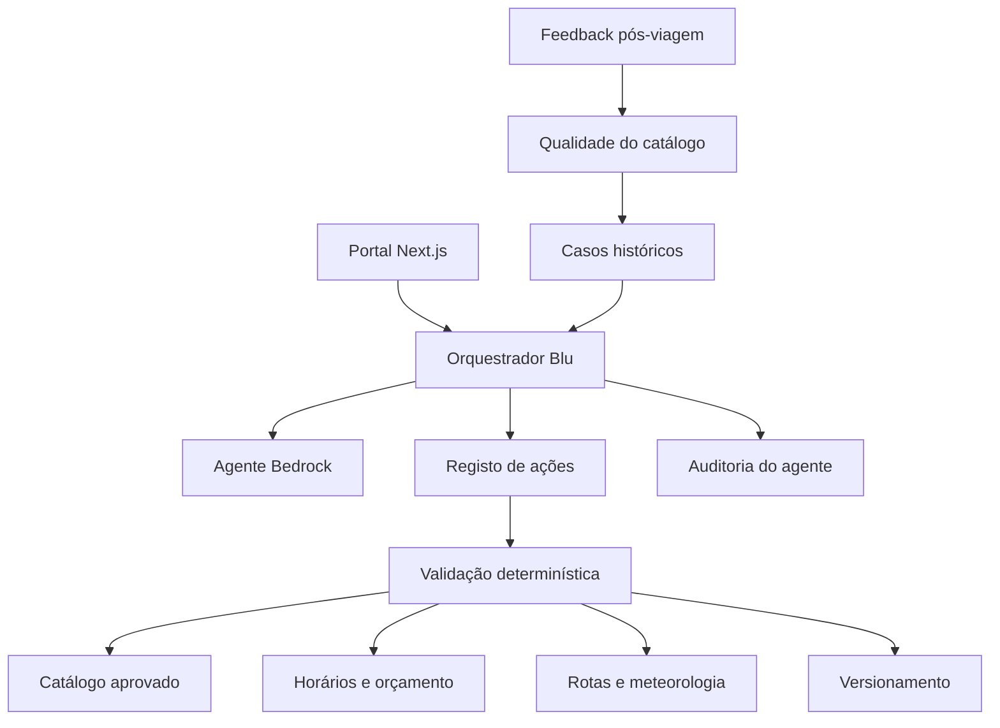

# Blu — Assistente de Curadoria

Revisto em 2026-10-16. Desenvolvimento no branch
`pc/assistant-agent-for-blu-curator`, preservando a integração HTML/Python.
Este documento mantém o âmbito e o estado das fases. Os contratos e comandos
operacionais estão em [docs/ASSISTANT.md](docs/ASSISTANT.md), as tarefas de cada
incremento em [PLAN.md](PLAN.md) e a evidência datada em
[docs/DECISIONS.md](docs/DECISIONS.md). Código e testes prevalecem sobre o plano.

## Estado atual

O Blu já propõe alterações estruturadas em linguagem natural através de Amazon
Bedrock Converse. O modelo predefinido é `eu.amazon.nova-pro-v1:0`, configurável.
Não existe modelo local nem fallback silencioso. A instância AWS executa apenas
orquestração e validação; o modelo executa no Bedrock com credenciais IAM.



Implementados nos primeiros incrementos das Fases 0 e 1:

- Contrato partilhado Python/TypeScript e oito tipos de ações.
- Validação integral, pré-visualização e aceitação/rejeição explícitas.
- Proteções, expiração, concorrência e auditoria na base de versões existente.
- Contexto recente limitado à viagem e proposta pendente validada no servidor.
- Alternativas reais do catálogo, sem inventar nomes, preços ou disponibilidade.
- Escolha de uma alternativa sem nova inferência; gravação só após aceitação.
- Mensagens e erros preservados no chat; «ok» não executa nem chama o modelo.
- Classificação segura de erros de permissões, formato, timeout e ligação.
- Template Lambda privado preparado, ainda sem deployment.

As Fases 0 e 1 permanecem parciais. Mover entre dias, otimizar percursos pelo
agente, editar briefing/confirmações, identificar o operador e avaliar amplamente
o modelo continuam pendentes. As Fases 2–6 não estão concluídas.

### Evidência e limites

- Última validação do portal: 104 testes aprovados, um ignorado; build aprovado.
- Interface em 390/1600 px validada com fornecedor simulado e dados temporários.
- Última validação Python do agente: 15 testes aprovados sem chamadas externas.
- Avaliador com 11 cenários sintéticos e comparação estrita de ações, dias, alvos
  e alternativas; recusa contrato inválido, ações adicionais e opções duplicadas.
- Casos incluem ambiguidade, proteções, ausência de candidatos e injeção em dados.
  A nova bateria ainda não foi executada no Bedrock.
- Nova Pro passou um cenário real de refinamento e alternativas; Nova Lite falhou
  duas tentativas anteriores. Esta amostra não comprova qualidade geral.
- Tokens e latência são registados; cálculo monetário de custos continua pendente.

Consultar os casos sem chamadas AWS:

```bash
python scripts/evaluate_agent.py --list
```

Execução real exige autorização aplicável para custos e `--live`; `--case`
permite selecionar cenários. Testes offline verificam o avaliador e os contratos,
não demonstram que o modelo resiste a todos os ataques ou interpreta todos os pedidos.

---

## 1. O que já existe

### Geração de itinerários

Já está implementado:

- Briefing dividido em etapas.
- Preferências, restrições, orçamento, mobilidade e alimentação.
- Geração com atividades, restaurantes e experiências.
- Aplicação de regras de curadoria.
- Horários propostos e deteção conservadora de conflitos.
- Distribuição por dias.
- Cálculo de preços conhecidos.
- Inclusão de deslocações.
- Persistência numa versão imutável.

A geração principal é determinística e passa por:

- `src/app/api/itineraries/route.ts`
- `src/lib/curation.ts`
- `src/lib/catalog-matching.ts`
- `src/lib/itinerary-scheduling.ts`
- `src/lib/road-routing.ts`

### Edição pelo assistente

A lógica determinística existente suporta comandos explícitos para:

- Adicionar uma oferta do catálogo.
- Substituir uma atividade.
- Reagendar.
- Reorganizar um dia.
- Remover.
- Criar períodos livres.
- Transformar um dia em dia livre.
- Ajustar a capacidade diária.
- Otimizar a sequência geográfica.

Também já protege atividades bloqueadas ou confirmadas e impede alterações incompatíveis com orçamento, horários, exclusões e regras.

O novo fluxo Bedrock permite adicionar, substituir, remover, reagendar,
reorganizar, ajustar capacidade, reservar manhã/tarde livre e marcar dia livre.
A otimização geográfica do editor existente ainda não é uma ação do planeador.

Os caminhos seguintes são relativos a `dmc-workspace/`:

- `src/lib/assistant-editing.ts`: regras determinísticas reutilizadas.
- `src/lib/assistant-actions.ts`: contrato, contexto, simulação e alternativas.
- `src/lib/agent-audit-store.ts`: proposta, decisão e ligação à versão.
- `src/app/api/assistant/plan/route.ts`: entrada do novo fluxo estruturado.
- `src/hooks/useWorkspace.ts`: conversa e interação com as propostas.

### Matching do catálogo

Já existe um perfil estruturado que permite associar registos a:

- Interesses.
- Nível Soft, Classic ou Signature.
- Ritmo.
- Horário de início.
- Alimentação.
- Mobilidade.
- Esforço físico.
- Idades.
- Capacidade do grupo.
- Orçamento.
- Preferência de acompanhamento.

Apenas itens aprovados devem entrar na geração determinística.

### Persistência e versionamento

Já existe:

- Histórico imutável de versões.
- Deteção de conflitos de edição.
- Hash do snapshot e cadeia de versões.
- PDFs e variantes linguísticas associados à versão.
- Preservação de propostas antigas após alterações no catálogo.
- Histórico de revisões do catálogo.
- Estados Rascunho, Em revisão, Aprovado e Inativo.

### Integrações existentes

- Open-Meteo para meteorologia.
- OSRM para rotas.
- Amazon Bedrock Converse no novo planeador; LangChain/LangGraph no serviço legado.
- Tradução local.
- Exportação PDF.
- Partilha por ligação ou documento.

---

## 2. O que está incompleto

### Edição e contexto ainda parciais

O novo endpoint `/api/assistant/plan` já interpreta pedidos e valida ações antes
de propor qualquer escrita. Ainda faltam mover entre dias, otimizar percursos
através do agente, editar o briefing e apoiar confirmações. Não há assistência
contextual completa em todas as páginas.

As propostas podem combinar até oito ações. Uma falha invalida o conjunto;
a capacidade diária e as atividades protegidas continuam a ser verificadas.
Isto não comprova interpretação correta de todos os pedidos compostos.

### Separação do serviço legado

O fluxo principal usa `src/blu_ai/planner.py`, candidatos aprovados pelo portal
e regras determinísticas existentes. Não usa a geração textual do endpoint
legado `/api/agent/curate`. Essa geração não está integrada no fluxo principal.
As ferramentas legadas não devem ser tratadas como autoridade paralela de regras.
A meteorologia Python já é partilhada entre portal e ferramenta do agente.

### Conversas e auditoria

As mensagens ficam no `localStorage`, separadas do snapshot autoritativo.
O planeador recebe até oito mensagens recentes, limitadas a 1000 caracteres por
mensagem e 6000 no total. Não há memória entre viagens.

A tabela `agent_runs`, na mesma `history.sqlite` das versões, guarda plano,
hash do pedido, decisão, versão de origem/executada e métricas. O texto original
do pedido não é guardado nesta tabela. Proposta e decisão não substituem uma
identidade autenticada do operador, ainda por implementar.

### Operação AWS e segurança

A cadeia normal de credenciais IAM está implementada, sem exigir chaves fixas.
A chamada tem timeout e falha explícita, sem modelo falso de fallback.
A orquestração Lambda está preparada, mas não publicada.

O serviço HTTP legado exige Bearer token, exceto na saúde, e não tem CORS público.
O fluxo principal valida a origem exata do portal. O contexto usa campos explícitos
para reduzir dados pessoais; o texto escrito no chat continua a ser enviado ao
Bedrock. Fontes e respostas externas são dados não fiáveis, nunca instruções.
Blocos de raciocínio interno e detalhes privados do SDK não são apresentados.

Continuam pendentes autenticação dos trabalhadores, permissões, consentimento,
finalidade e retenção operacional. O portal não está validado para exposição
pública multiutilizador. As proteções atuais não equivalem a resistência geral
comprovada contra injeção de instruções.

### Avaliação ainda limitada

Há testes automatizados de contrato, falhas AWS simuladas, propostas, proteções,
concorrência, rollback e interface. O avaliador foi alargado a 11 casos sintéticos,
mas esta bateria ainda não foi executada no fornecedor real. Falta avaliação ampla
por personas, qualidade das explicações, grounding, injeção, latência e custo
monetário. Uma resposta sem ações passa o critério de não escrita; não comprova
que o esclarecimento textual seja adequado.

---

## 3. O que falta desenvolver

### Feedback pós-viagem

Não existe atualmente um modelo de feedback individual por atividade.

Será necessário guardar:

- Viagem e versão efetivamente realizadas.
- Identificador estável do item do catálogo.
- Revisão do catálogo usada.
- Estado: realizada, cancelada, substituída ou não aplicável.
- Avaliação geral.
- Qualidade da experiência.
- Exatidão da descrição.
- Qualidade do fornecedor.
- Adequação do horário e duração.
- Relação qualidade/preço.
- Acessibilidade.
- Cumprimento de restrições alimentares.
- Comentário do trabalhador.
- Data e autor da avaliação.

O questionário deve exigir uma resposta para cada card, mas permitir “Não aplicável” quando a atividade não se realizou.

### Qualidade do catálogo

É necessário criar agregados por item:

- Número de utilizações.
- Número de avaliações.
- Média e distribuição.
- Taxa de cancelamento.
- Taxa de substituição.
- Problemas recorrentes.
- Tendência nos últimos 30, 90 e 180 dias.
- Data da última utilização.
- Estado do alerta.

Um alerta não deve desativar automaticamente o item. O trabalhador deverá poder:

1. Consultar as avaliações.
2. Rever o registo.
3. Manter ativo.
4. Colocar em revisão.
5. Inativar.

A inativação deve impedir novas recomendações e preservar todo o histórico.

### Knowledge Base histórica

Existem itinerários e PDFs históricos, mas não existe uma camada operacional que os transforme em casos reutilizáveis.

A primeira versão não precisa de uma base vetorial. Pode usar:

- Campos estruturados do briefing.
- Destino.
- Datas e duração.
- Tipo de grupo.
- Interesses.
- Restrições.
- Nível da proposta.
- Itens selecionados.
- Alterações do trabalhador.
- Feedback final.
- Resultado das recomendações anteriores.

Uma pesquisa por similaridade estruturada e texto integral em SQLite/PostgreSQL será mais simples, barata e explicável.

Embeddings devem ser adicionados apenas se os testes mostrarem que a pesquisa estruturada não é suficiente.

---

## 4. Arquitetura recomendada



### Princípio central

O modelo não deve alterar diretamente:

- Itinerários.
- Catálogo.
- Confirmações.
- Versões.
- Estado de aprovação.
- Lixo.

O contrato atual (`src/blu_ai/schemas/action-plan.json`) exige ações estruturadas,
por exemplo (identificadores ilustrativos):

```json
{
  "summary": "Substituir a atividade da tarde por uma opção coberta.",
  "actions": [
    {
      "type": "replace_item",
      "dayNumber": 2,
      "itemId": "catalog:item-123",
      "catalogId": "catalog:item-456"
    }
  ],
  "warnings": [],
  "requiresConfirmation": true
}
```

Depois:

1. O Next.js valida o schema.
2. Resolve os identificadores.
3. Executa a lógica determinística existente.
4. Mostra uma pré-visualização.
5. O trabalhador aceita ou rejeita.
6. A alteração aceite cria uma versão.
7. A decisão fica registada para aprendizagem futura.

### Registo de ações

Disponíveis: `add_catalog_item`, `replace_item`, `remove_item`,
`reschedule_item`, `reorder_day`, `set_day_capacity`, `add_free_period` e
`set_free_day`. `alternatives` é um campo separado para opções de substituição,
não uma ação que as aplique.

Por implementar: `move_item`, `optimize_route`, `update_brief` e
`update_pending_confirmation`. Os nomes são propostas, não contratos ativos.

Todas as ações atuais exigem confirmação humana. Atividades bloqueadas ou
confirmadas são recusadas; a aceitação de uma proposta não contorna essa proteção.
O agente não dispõe de ações de edição do catálogo.

### Fonte única de regras

A lógica TypeScript deve continuar a ser a autoridade para:

- Elegibilidade.
- Horários.
- Preços.
- Orçamento.
- Mobilidade.
- Alimentação.
- Estados do catálogo.
- Proteções.
- Versionamento.

O Python deve consultar essa lógica através de APIs ou receber candidatos já validados. Não deve manter uma segunda implementação independente das regras.

---

## 5. Modelo de dados recomendado

### Auditoria do agente

A implementação atual usa uma única tabela `agent_runs` na base de versões,
com plano JSON e decisão; não criou `agent_actions` nem outra persistência.
Guarda hash do pedido em vez do texto original e ainda não identifica o operador.
Os campos e a segunda tabela abaixo são propostas históricas para revisão,
não o esquema implementado. Confirmar o esquema em `agent-audit-store.ts`.

Proposta histórica para `agent_runs`:

- `id`
- `trip_id`
- `base_version`
- `user_id`
- `instruction`
- `model_provider`
- `model_id`
- `created_at`
- `completed_at`
- `status`
- `latency_ms`
- `input_hash`
- `error_code`

Proposta histórica para `agent_actions` (não implementada):

- `run_id`
- `sequence`
- `action_type`
- `arguments`
- `validation_result`
- `explanation`
- `accepted_at`
- `rejected_at`
- `executed_version`
- `rejection_reason`

### Feedback

Nova tabela `trip_feedback`:

- `id`
- `trip_id`
- `version`
- `completed_by`
- `completed_at`
- `overall_notes`

Nova tabela `item_feedback`:

- `trip_feedback_id`
- `itinerary_item_id`
- `catalog_id`
- `catalog_revision`
- `outcome`
- `overall_rating`
- `accuracy_rating`
- `supplier_rating`
- `schedule_rating`
- `value_rating`
- `accessibility_rating`
- `dietary_rating`
- `issue_tags`
- `comment`

Nova tabela `catalog_quality_alerts`:

- `catalog_id`
- `alert_type`
- `severity`
- `evidence`
- `created_at`
- `resolved_at`
- `resolved_by`
- `resolution`

### Casos históricos

Nova tabela `historical_cases` ou uma vista materializada com:

- Briefing normalizado.
- Snapshot final.
- Itens utilizados.
- Alterações aceites e rejeitadas.
- Feedback.
- Resultado por item.
- Qualidade global.

Os dados históricos devem referenciar identificadores estáveis, nunca apenas nomes.

---

## 6. Funcionalidades adicionais de IA

### Prioridade alta

#### Verificação preventiva da proposta

Antes de exportar:

- Detetar sobreposições.
- Identificar horários não confirmados.
- Verificar preços desconhecidos.
- Detetar atividades incompatíveis.
- Sinalizar dias demasiado preenchidos.
- Confirmar que todas as deslocações são possíveis.

#### Recomendações proativas

O Blu pode apresentar sugestões sem alterar:

- Alternativa para chuva.
- Alternativa acessível.
- Alternativa dentro do orçamento.
- Substituição de um item com avaliações negativas.
- Atividade próxima para reduzir deslocações.
- Restaurante compatível com a dieta.

#### Explicabilidade

Cada recomendação deve mostrar:

- Preferências correspondentes.
- Regras aplicadas.
- Dados usados.
- Alertas.
- Informação desconhecida.
- Razão para rejeitar alternativas.

#### Qualidade do briefing

Antes de gerar, o agente pode identificar:

- Respostas contraditórias.
- Campos importantes em falta.
- Orçamento incompatível com o nível pretendido.
- Mobilidade que exige esclarecimento.
- Restrições alimentares sem detalhe suficiente.

### Prioridade média

#### Gestão de perturbações

- Chuva.
- Encerramento inesperado.
- Atraso no voo.
- Cancelamento de fornecedor.
- Alteração de horário.

O Blu deve propor um plano alternativo e mostrar o impacto antes da aplicação.

#### Análise das decisões dos trabalhadores

Registar:

- Recomendações aceites.
- Recomendações rejeitadas.
- Alterações manuais posteriores.
- Itens frequentemente substituídos.
- Motivos de rejeição.

Isto permite ajustar o ranking sem treinar diretamente o modelo com dados não revistos.

#### Qualidade de conteúdo

- Detetar descrições desatualizadas.
- Identificar duplicados no catálogo.
- Sugerir campos em falta.
- Verificar consistência entre idiomas.
- Detetar texto pouco adequado a uma proposta para cliente.

### Prioridade posterior

- Previsão de probabilidade de aceitação de uma proposta.
- Estimativa de risco operacional.
- Previsão de duração real.
- Otimização multiobjetivo entre satisfação, custo e deslocação.

Estas funcionalidades exigem dados de resultado suficientes e não devem ser implementadas antes do feedback estruturado.

---

## 7. Plano por fases

### Fase 0 — Contratos, segurança e avaliação

Prioridade: crítica.

- [x] Definir ações estruturadas do agente.
- [x] Definir quais exigem confirmação humana.
- [x] Criar schemas comuns entre TypeScript e Python.
- [x] Corrigir Bedrock para usar IAM Role.
- [x] Restringir CORS.
- [x] Remover dados pessoais e instruções dos logs.
- [ ] Impedir que conteúdo do catálogo seja tratado como instrução.
- [x] Não expor raciocínio interno do modelo.
- [ ] Criar conjunto de testes e personas.
- [ ] Medir grounding, validade, latência e custo.

Estado parcial: separação entre dados e instruções implementada no prompt e
validação, mas resistência ampla a injeção ainda não comprovada. Existem 11 casos
sintéticos e testes automatizados; personas e avaliação real ampla estão pendentes.
Latência e tokens são medidos; custo monetário não é calculado.

Esta fase é dependência de todas as restantes.

### Fase 1 — Blu como editor transacional

Prioridade: crítica.

- [x] Criar endpoint de planeamento de ações.
- [x] Fazer o Bedrock devolver ações estruturadas.
- [x] Validar cada ação no Next.js.
- [x] Apresentar pré-visualização antes/depois.
- [x] Permitir aceitar ou rejeitar.
- [x] Executar usando a lógica existente.
- [ ] Permitir comandos compostos, como aliviar um dia, preservar reservas confirmadas e reduzir o custo numa única operação.
- [ ] Adaptar a assistência à página aberta: briefing, catálogo, itinerário, confirmações ou exportação.
- [ ] Apoiar o preenchimento das confirmações, referências, preços e evidências ainda em falta.
- [x] Disponibilizar um modo de simulação que calcule o impacto sem guardar imediatamente.
- [x] Criar uma versão após aceitação.
- [ ] Resumir as alterações entre versões, incluindo atividades, horários, preços e orçamento.
- [ ] Registar pedido, ação, validação e decisão.

Estado parcial: até oito ações compostas são simuladas atomicamente; interpretação
ampla de pedidos compostos e redução de custos ainda exigem avaliação. Auditoria
de plano, hash do pedido e decisão implementada; identidade do operador e registo
detalhado de cada validação continuam pendentes. Há pré-visualização antes/depois,
mas não um resumo completo de diferenças de horários, preços e orçamento.

Resultado pretendido: executar linguagem natural sem contornar regras.

### Fase 2 — Geração e matching assistidos

Prioridade: alta.

- Manter a geração determinística como base.
- Pedir ao agente para ordenar candidatos elegíveis.
- Recuperar casos históricos semelhantes.
- Mostrar razões do ranking.
- Explicar que respostas do briefing e regras de curadoria sustentam cada recomendação.
- Diagnosticar conflitos de horário, deslocações inviáveis, excesso de atividades, orçamento ultrapassado e informação em falta.
- Propor alternativas elegíveis quando uma atividade estiver fechada, exceder o orçamento ou contrariar restrições.
- Comparar a proposta do agente com a proposta base.
- Nunca permitir que o modelo introduza um item inexistente ou inativo.
- Guardar a origem de cada recomendação.

### Fase 3 — Feedback pós-viagem

Prioridade: alta.

- Criar estado “Viagem concluída — feedback pendente”.
- Apresentar questionário card a card.
- Tornar obrigatória uma resposta ou “Não aplicável”.
- Guardar avaliações ligadas à versão e revisão do catálogo.
- Criar página de histórico de avaliações.
- Calcular tendências e alertas.
- Detetar registos incompletos, duplicados, desatualizados ou com avaliações negativas.
- Propor correções do catálogo para aprovação humana.
- Permitir ao trabalhador colocar o item em revisão ou inativá-lo.
- Preservar todas as avaliações após inativação.

### Fase 4 — Knowledge Base histórica

Prioridade: média.

- Indexar snapshots finais.
- Indexar alterações e decisões do trabalhador.
- Associar feedback.
- Criar pesquisa por casos semelhantes.
- Reutilizar estruturas de propostas bem avaliadas sem copiar dados pessoais dos clientes.
- Usar filtros estruturados e pesquisa textual.
- Avaliar ganhos antes de adicionar embeddings.
- Excluir casos sem qualidade mínima ou sem resultado conhecido.

### Fase 5 — Integrações e proatividade

Prioridade: média.

- Unificar meteorologia e rotas como adaptadores do portal.
- Acrescentar cache, timeout e provenance.
- Criar alertas de chuva, encerramento e conflito.
- Apresentar indicadores proativos, incluindo reservas sem confirmação, desvio do orçamento e atividades exteriores afetadas pela meteorologia.
- Permitir regeneração parcial de um dia.
- Calcular deslocações e reorganizar o dia perante alterações meteorológicas, atrasos ou indisponibilidades.
- Integrar voos quando existir uma API escolhida.
- Preparar fornecedores, mapas ou reservas sem confirmar automaticamente.
- Preparar o email de partilha e um resumo da proposta no idioma do cliente, sempre sujeitos a revisão.

### Fase 6 — Operação e melhoria contínua

- Dashboard de desempenho do Blu.
- Taxa de aceitação das sugestões.
- Motivos de rejeição.
- Frequência de correções manuais.
- Executar um controlo de qualidade antes da exportação, cobrindo conteúdo, idiomas, preços, reservas e campos pendentes.
- Custos e latência.
- Testes periódicos contra regressão e prompt injection.
- Comparação controlada de modelos.
- Aprovação humana antes de alterar prompts ou rankings.

---

## 8. Mapa de implementação e evolução

### Portal existente

Os itens seguintes incluem evolução futura. O fluxo atual usa
`src/lib/assistant-actions.ts`, `src/lib/assistant-conversation.ts` e
`src/lib/agent-audit-store.ts`, relativos a `dmc-workspace/`.

- `dmc-workspace/src/app/api/assistant/plan/route.ts`
  - Orquestração, validação e decisões das propostas estruturadas.

- `dmc-workspace/src/components/AIAssistantPanel.tsx`
  - Pré-visualização, explicações, aceitar e rejeitar.

- `dmc-workspace/src/hooks/useWorkspace.ts`
  - Aplicação, persistência e versionamento das ações.

- `dmc-workspace/src/lib/assistant-editing.ts`
  - Extrair comandos para um registo de ações reutilizável.

- `dmc-workspace/src/lib/catalog-matching.ts`
  - Ranking explicável e sinais históricos.

- `dmc-workspace/src/lib/curation.ts`
  - Geração base e integração do ranking.

- `dmc-workspace/src/lib/snapshot-validation.ts`
  - Metadados do agente e feedback, quando aplicável.

- `dmc-workspace/src/lib/version-store.ts`
  - Auditoria, feedback e ligação às versões.

- `dmc-workspace/src/lib/catalog-store.ts`
  - Alertas de qualidade e histórico de avaliações.

- `dmc-workspace/src/types/index.ts`
  - Contratos das ações, recomendações e feedback.

- `dmc-workspace/src/app/catalog/page.tsx`
  - Qualidade, tendências, alertas e decisão de inativação.

- `dmc-workspace/src/components/ActivityCard.tsx`
  - Estado do feedback e explicação da recomendação.

- `dmc-workspace/src/lib/activity-confirmation.ts`
  - Apoio do agente aos dados e evidências ainda em falta.

- `dmc-workspace/src/lib/proposal-budget.ts` e `dmc-workspace/src/lib/itinerary-pdf.ts`
  - Diagnóstico de preços, controlo de qualidade e validação antes da exportação.

- `dmc-workspace/src/app/api/shares/route.ts`
  - Preparação assistida e supervisionada da comunicação com o cliente.

### Módulos existentes e módulos futuros

`assistant-actions.ts` e `agent-audit-store.ts` já existem. Os restantes nomes
abaixo são sugestões de decomposição futura, não módulos obrigatórios.

- `src/lib/assistant-actions.ts`
- `src/lib/assistant-policy.ts`
- `src/lib/agent-audit-store.ts`
- `src/lib/feedback-store.ts`
- `src/lib/catalog-quality.ts`
- `src/lib/historical-cases.ts`
- `src/lib/proposal-diagnostics.ts`
- `src/lib/export-quality.ts`
- `src/components/AssistantActionPreview.tsx`
- `src/components/AssistantDiagnostics.tsx`
- `src/components/PostTripFeedback.tsx`
- `src/app/feedback/[tripId]/page.tsx`
- `src/app/api/feedback/route.ts`
- `src/app/api/catalog/quality/route.ts`

### Serviço Python

O planeador atual é `src/blu_ai/planner.py`; o contrato partilhado está em
`src/blu_ai/schemas/action-plan.json`. O template privado encontra-se em
`infra/assistant/template.yaml`. Os módulos LangGraph abaixo são legados e não
são a entrada do novo fluxo.

- `src/blu_ai/api/server.py`
  - Endpoints autenticados e contratos estruturados.

- `src/blu_ai/agents/curator_agent.py`
  - Planeamento de ações em vez de respostas livres.

- `src/blu_ai/agents/prompts.py`
  - Separação entre dados, regras e instruções.

- `src/blu_ai/schemas/itinerary.py`
  - Schemas de planos e ações.

- `src/blu_ai/tools/catalog_tools.py`
  - Deixar de pesquisar diretamente dados sem passar pela autoridade do portal.

- `src/blu_ai/tools/constraint_tools.py`
  - Remover duplicação ou transformar numa chamada à validação central.

- `src/blu_ai/config.py` e `src/blu_ai/llm.py`
  - IAM Role, configuração segura e falha explícita.

### Testes

- Testes dos schemas de ação.
- Testes de autorização e confirmação.
- Testes de grounding.
- Testes de prompt injection.
- Testes de itens inativos.
- Testes de feedback completo.
- Testes de alertas e tendências.
- Testes de preservação histórica.
- Testes de diagnóstico, alternativas e comandos compostos.
- Testes do modo de simulação e do resumo entre versões.
- Testes de controlo de qualidade antes da exportação.
- Testes da preparação de comunicações sem envio automático.
- Testes de falha explícita quando Bedrock está indisponível, sem fallback de modelo.
- Testes ponta a ponta: pedido → proposta → aprovação → versão.

---

## 9. Decisões recomendadas

1. **Manter a lógica de negócio no Next.js/TypeScript.**
2. **Usar o Bedrock para interpretar, planear, explicar e ordenar.**
3. **Nunca permitir escrita direta do agente na base de dados.**
4. **Exigir aprovação humana para alterações críticas.**
5. **Começar a Knowledge Base com SQL e pesquisa textual.**
6. **Adicionar embeddings apenas depois de medir necessidade.**
7. **Não realizar aprendizagem automática antes de existir feedback estruturado.**
8. **Usar as decisões dos trabalhadores como sinal auditável, sem autoajuste invisível.**
9. **Migrar a persistência para uma base central antes de utilização multiutilizador em produção.**
10. **Manter itinerários e PDFs históricos imutáveis.**

A primeira entrega deve abranger as **Fases 0 e 1**. Isso transforma o Blu num agente realmente útil sem comprometer catálogo, confirmações, versões ou supervisão humana. Todas as fases seguintes fazem parte do âmbito de implementação aprovado neste plano e devem manter a pré-visualização e a confirmação do trabalhador antes de alterar itinerários, catálogo, preços ou estados.
