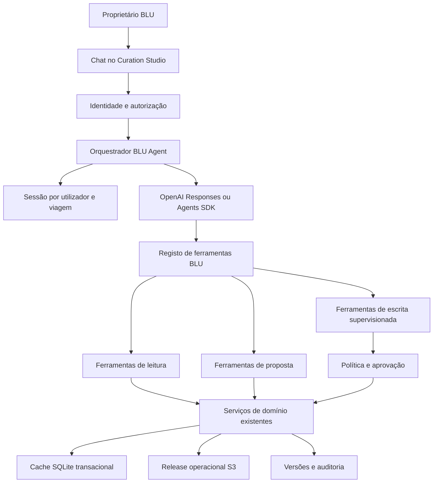

# Agente OpenAI/Codex para o BLU Curation Studio

Revisto em 24 de outubro de 2026. Este documento descreve como substituir o
planeador Amazon Bedrock por um agente OpenAI e como evoluir esse agente até poder
usar, sob autorização, as funcionalidades do portal.

Este é o briefing técnico do agente para o branch atual. Parte dos contratos que já
estão implementados e define os módulos que precisam de ser criados para o agente
OpenAI/Codex cobrir o ciclo completo de curadoria. As tarefas aprovadas continuam
em [PLAN.md](PLAN.md) e os contratos atuais do chatbot estão em
[docs/ASSISTANT.md](docs/ASSISTANT.md).

## Resposta direta

É possível integrar no portal um agente baseado em modelos OpenAI com ferramentas e
comportamento semelhantes aos do Codex. Não é possível transportar diretamente para
o portal esta sessão, a memória desta conversa ou a identidade do assistente que a
está a executar. O portal criará uma nova instância do **BLU Agent**, com instruções,
sessões, ferramentas, permissões e auditoria próprias.

Também não se deve depender da interface de consumidor do ChatGPT como backend do
portal. A integração suportada é feita pela OpenAI API. O ChatGPT pode, noutra fase,
ser um cliente do BLU através de ações ou MCP, mas o estado autoritativo e as regras
continuam no backend do projeto.

A recomendação é:

1. preservar a interface de chat e o fluxo transacional já existentes;
2. criar uma abstração de fornecedor para Bedrock e OpenAI;
3. integrar primeiro a OpenAI Responses API ou Agents SDK;
4. expor as capacidades do portal como ferramentas tipadas;
5. adicionar sessões duráveis por utilizador e viagem;
6. considerar a Agents API com harness Codex apenas para tarefas longas que
   precisem de ficheiros, código ou um sandbox.

Referências oficiais:

- [OpenAI — visão geral de Agents](https://developers.openai.com/api/docs/guides/agents)
- [OpenAI — Agents API e harness Codex](https://developers.openai.com/api/docs/guides/agents-api/overview)
- [OpenAI — function calling](https://developers.openai.com/api/docs/guides/function-calling)
- [OpenAI — estado de conversa](https://developers.openai.com/api/docs/guides/conversation-state)
- [OpenAI — ChatKit](https://developers.openai.com/api/docs/guides/chatkit)
- [OpenAI — segurança de sandboxes](https://developers.openai.com/api/docs/guides/agents-api/environments/security)

## O que o agente precisa para funcionar

O agente OpenAI/Codex só fica operacional no portal quando existirem, em conjunto:

1. uma chave de aplicação OpenAI guardada no servidor e um projeto com limites;
2. um adaptador OpenAI que devolva o contrato de ações BLU;
3. autenticação individual no portal e identificação do `owner`;
4. contexto reconstruído a partir da versão autoritativa de cada viagem;
5. ferramentas tipadas que chamem os serviços de domínio existentes;
6. política de autorização e aprovação por ferramenta;
7. sessões duráveis, revogáveis e associadas a utilizador e viagem;
8. auditoria de propostas, decisões, versões, tokens, custo e falhas;
9. testes de contrato, permissões, concorrência, injeção e recuperação;
10. uma política aprovada para dados enviados à OpenAI, retenção e eliminação.

Sem estes elementos, é possível trocar Nova Pro por um modelo OpenAI, mas não é
seguro afirmar que o agente controla todas as funcionalidades do portal.

## Base deste branch

O chatbot operacional usa:

- `dmc-workspace/src/app/api/assistant/plan/route.ts` para pedidos, propostas e
  decisões;
- `src/blu_ai/planner.py` para uma chamada Bedrock Converse;
- `src/blu_ai/schemas/action-plan.json` como contrato partilhado;
- `dmc-workspace/src/lib/assistant-actions.ts` para validar e simular;
- `dmc-workspace/src/lib/agent-audit-store.ts` para auditoria e ligação às versões;
- `dmc-workspace/src/hooks/useWorkspace.ts` para a conversa e aceitação no browser.

O modelo recebe um subconjunto explícito do questionário, o itinerário, candidatos
aprovados e até oito mensagens recentes. Devolve uma proposta; o portal volta a
validá-la, mostra o antes/depois e só grava após aceitação explícita.

O contrato ativo contém onze ações:

- `add_catalog_item`;
- `replace_item`;
- `remove_item`;
- `reschedule_item`;
- `reorder_day`;
- `set_day_capacity`;
- `add_free_period`;
- `set_free_day`;
- `move_item`;
- `optimize_route`;
- `regenerate_day`.

O planeador atual identifica sempre o fornecedor como `bedrock`, e a rota rejeita
qualquer outro valor. A conversa fica no navegador e não existe sessão durável do
agente no servidor.

Esta base é o ponto de partida. As capacidades adicionais são introduzidas sobre os
stores, APIs e regras existentes, sem importar implementações de outros branches e
sem criar autoridades paralelas para catálogo, itinerários ou versões.

### Contrato alvo

As onze ações existentes permanecem como núcleo inicial. A evolução acrescenta duas
ações transacionais, sempre sujeitas a pré-visualização e aceitação:

- `update_brief`, limitada a campos explicitamente autorizados;
- `update_pending_confirmation`, limitada a confirmações ainda pendentes e sem
  inventar reserva, preço, contacto ou evidência.

`ranking` continua a ser uma ferramenta de leitura: ordena candidatos elegíveis,
mas não adiciona nem substitui atividades. Feedback, qualidade e casos históricos
são serviços de domínio consultados por ferramentas; não são ações de escrita do
modelo.

## Opções de integração

| Opção | Utilização no BLU | Estado e ferramentas | Adequação |
| --- | --- | --- | --- |
| Responses API | Substituir apenas a interpretação Bedrock, mantendo a orquestração atual | O BLU guarda estado e executa function calls | Melhor primeiro incremento |
| Agents SDK | Agente com várias ferramentas, guardrails, sessões e tracing geridos pela aplicação | O runtime continua sob controlo do BLU | Recomendado para a evolução completa |
| Agents API | Harness Codex gerido pela OpenAI, sessões duráveis e sandbox opcional | OpenAI gere o ciclo; o BLU fornece funções e ambiente | Adequado a tarefas longas ou técnicas |
| ChatKit | Componente visual de chat incorporável | Liga-se a um agente alojado no servidor | Opcional; o portal já tem uma UI própria |
| ChatGPT como cliente | Utilizador conversa no ChatGPT, que chama APIs BLU autorizadas | Exige ações ou MCP e autenticação própria | Complemento futuro, não substituto do backend |

### Escolha recomendada

Para substituir Bedrock sem reescrever o portal, usar inicialmente a **Responses
API** com uma única função `propose_actions` e o schema atual. O resultado continua
a passar pelo mesmo simulador, validação, pré-visualização e versão.

Depois, usar o **Agents SDK** quando o agente tiver várias ferramentas de leitura e
escrita. A Agents API com Codex é útil se o agente também precisar de gerar
artefactos, analisar muitos ficheiros ou executar tarefas demoradas. Não é necessária
para editar um itinerário e não deve receber acesso direto à máquina de produção.

## Arquitetura proposta



O modelo escolhe ferramentas e argumentos. O backend autentica o utilizador,
valida os argumentos, verifica a versão, executa a lógica determinística e devolve
um resultado reduzido. O modelo nunca escreve diretamente em SQLite, S3 ou no
filesystem.

## Relação de autoridade

O utilizador com papel `owner` é o responsável máximo do espaço BLU. Essa relação
não deve existir apenas no prompt; tem de ser aplicada por autenticação e política.

| Classe | Exemplos | Regra |
| --- | --- | --- |
| Leitura | Questionário, itinerário, catálogo, histórico, sinais | Execução automática dentro do âmbito autorizado |
| Análise | Diagnóstico, ranking, alternativas, impacto | Automática e sem escrita |
| Escrita normal | Alterar briefing ou itinerário | Pré-visualização e aceitação explícita |
| Escrita sensível | Confirmações, catálogo, partilhas, Lixo | Confirmação reforçada e auditoria |
| Operação | Backups, restauros, `just blu it` | Apenas `owner/admin`, autenticação adicional |
| Infraestrutura | IAM, buckets, deployment e segredos | Processo separado; nunca uma ferramenta comum do chat |

O agente pode preparar qualquer alteração permitida. O utilizador continua a decidir
quando uma operação cria efeitos. Operações destrutivas, financeiras, externas ou de
infraestrutura não são autorizadas por frases genéricas como «faz tudo».

## Contexto de cada itinerário

A sessão deve usar a chave lógica:

```text
user_id + trip_id + base_version + agent_session_id
```

Em cada turno, o backend recompõe o contexto a partir das fontes autoritativas:

- questionário atual;
- versão e hash do snapshot;
- itinerário atual;
- atividades protegidas e confirmações;
- catálogo aprovado relevante;
- preços conhecidos e pendências por moeda;
- regras de curadoria aplicadas;
- propostas do agente ainda pendentes;
- decisões anteriores da mesma sessão;
- resumo reduzido da conversa.

O contexto atual omite campos logísticos já existentes. Devem ser acrescentados à
lista explícita de `plannerContext`:

- local, hora e número do voo de chegada;
- local, hora e número do voo de partida;
- ocasião especial.

Nome, email, notas internas, referências de reserva e contactos permanecem excluídos
por defeito. Uma ferramenta que precise de um dado sensível recebe apenas o campo
necessário e exige finalidade autorizada.

Uma sessão OpenAI pode conservar continuidade, mas não substitui o snapshot BLU. A
cada turno, a versão e o estado atual são novamente fornecidos. Uma conversa antiga
não pode alterar uma versão nova sem nova simulação.

## Registo de ferramentas

As ferramentas devem chamar serviços de domínio, não páginas React nem cliques de
browser. Cada ferramenta tem schema estrito, papel mínimo, idempotency key, versão
base, resultado sanitizado e política de aprovação.

### Leitura

- `get_trip_context(trip_id, version)`
- `get_brief(trip_id, version)`
- `get_itinerary(trip_id, version)`
- `get_pending_confirmations(trip_id, version)`
- `search_approved_catalog(filters)`
- `get_catalog_item(catalog_id, revision)`
- `get_trip_history(trip_id)`
- `get_export_status(trip_id, version)`
- `get_weather(location, date)`
- `estimate_route(points)`
- `get_operational_signals(scope)`

### Proposta e simulação

- `propose_itinerary_actions(actions, base_version)`
- `rank_catalog_candidates(criteria)`
- `diagnose_proposal(trip_id, version)`
- `simulate_brief_update(patch, base_version)`
- `simulate_confirmation_update(item_id, patch, base_version)`
- `compare_versions(trip_id, before_version, after_version)`
- `prepare_share(trip_id, version, locale, method)`
- `prepare_export(trip_id, version, locale, format)`

Estas ferramentas não escrevem. Produzem uma proposta assinada, impacto, avisos e
um identificador de aprovação.

### Escrita supervisionada

- `apply_itinerary_proposal(proposal_id, approval_token)`
- `apply_brief_proposal(proposal_id, approval_token)`
- `apply_confirmation_proposal(proposal_id, approval_token)`
- `save_catalog_revision(proposal_id, approval_token)`
- `change_catalog_status(proposal_id, approval_token)`
- `create_export(proposal_id, approval_token)`
- `create_share(proposal_id, approval_token)`
- `trash_version(proposal_id, approval_token)`
- `restore_version(proposal_id, approval_token)`

O token de aprovação é emitido pelo servidor para uma operação, utilizador, viagem,
versão, hash e prazo específicos. Não é reutilizável noutra ação.

### Operação restrita

- `request_backup()`
- `request_restore(checkpoint_id)`
- `request_system_recovery()`

Estas ferramentas devem iniciar um fluxo administrativo independente. Não recebem
shell genérico, credenciais AWS ou acesso arbitrário ao filesystem. O comando
`just blu it` conserva a sua autenticação e apresenta o plano antes da execução.

## Funcionalidades do agente completo neste branch

### Editor transacional

O agente deve conseguir propor:

- adicionar, remover e substituir ofertas;
- alterar horários;
- mover atividades entre dias;
- reorganizar um dia;
- ajustar capacidade diária;
- criar períodos ou dias livres;
- otimizar uma rota;
- regenerar parcialmente um dia;
- alterar campos permitidos do briefing;
- preparar confirmações ainda pendentes.

Todas as alterações reutilizam as regras atuais, preservam bloqueios e confirmações
e criam uma versão apenas depois da aceitação.

### Matching e explicabilidade

O agente pode ordenar apenas candidatos previamente elegíveis. Cada recomendação
mostra:

- preferências correspondentes;
- regras e fontes usadas;
- preço conhecido e respetiva moeda;
- informação em falta;
- impacto em horários, deslocações e orçamento;
- razão para excluir alternativas.

O modelo não cria IDs, preços, disponibilidade ou confirmações.

### Verificação preventiva

Antes da exportação, ferramentas determinísticas verificam:

- sobreposições e horários desconhecidos;
- capacidade e ritmo diário;
- atividades protegidas;
- preços e moedas pendentes;
- restrições alimentares e de mobilidade;
- deslocações estimadas ou inviáveis;
- confirmações e reservas incompletas;
- consistência do idioma e do documento.

O agente explica o relatório e prepara correções, mas não transforma avisos em fatos.

### Proatividade

Pode sugerir, sem escrever:

- alternativa para chuva;
- opção acessível;
- redução de custo;
- substituição de item com qualidade baixa;
- atividade próxima para reduzir deslocações;
- restaurante compatível com restrições;
- reorganização após atraso ou encerramento.

Meteorologia histórica não é apresentada como previsão. Rotas estimadas não são
apresentadas como tempos confirmados. Voos só entram depois de existir uma API,
contrato, custo e política de dados aprovados.

### Feedback e qualidade do catálogo

Criar neste branch os serviços de feedback e qualidade sobre a base de versões e o
catálogo já existentes:

- feedback card a card ligado à versão realizada;
- resultados realizada/cancelada/substituída/não aplicável;
- métricas por item e janelas temporais;
- alertas de qualidade sujeitos a decisão humana;
- preservação do histórico após inativação;
- auditoria do trabalhador que decidiu.

Um alerta nunca altera automaticamente o estado do catálogo.

### Casos históricos

Começar com pesquisa estruturada e textual sobre casos aprovados. Um caso elegível
usa um perfil reduzido, IDs estáveis, revisões e resultado conhecido. Exclui nomes,
contactos, comentários livres, PDFs e casos no Lixo.

Embeddings só são introduzidos depois de comparar relevância e custo com a pesquisa
estruturada. O agente não aprende automaticamente com feedback nem altera prompts ou
ranking sem revisão.

### Exportação e comunicação

O agente pode preparar:

- resumo da proposta;
- TXT para Canva;
- PDF e variantes linguísticas;
- email ou texto de partilha;
- lista de pendências antes da entrega.

A criação e a partilha exigem revisão. O agente não envia mensagens, confirma
reservas ou publica documentos sem uma ferramenta e aprovação explícitas.

## Persistência proposta

Manter `agent_runs`, acrescentando apenas campos necessários para identidade e
fornecedor:

- `user_id`;
- `agent_session_id`;
- `provider`;
- `model_id`;
- `base_version` e `executed_version`;
- hash do pedido;
- plano validado;
- decisão e motivo;
- tokens, latência e custo estimado;
- estado e código de erro.

Criar uma tabela ou store de sessões com:

- `session_id`;
- `user_id`;
- `trip_id`;
- `current_version`;
- identificador de conversa do fornecedor, quando usado;
- resumo sanitizado;
- data de criação, utilização e expiração;
- estado de revogação.

Não guardar raciocínio interno, chaves, tokens, contactos ou o questionário inteiro
na sessão. O snapshot autoritativo continua no histórico de versões.

## Substituição técnica do Bedrock

### Passo 1 — Interface de fornecedor

Criar um contrato Python único:

```python
class AgentProvider(Protocol):
    def propose_actions(self, instruction: str, context: dict) -> AgentResult: ...
```

Implementações:

- `BedrockAgentProvider`, contendo o comportamento atual;
- `OpenAIAgentProvider`, usando Responses API ou Agents SDK.

Selecionar por `BLU_AGENT_PROVIDER=bedrock|openai`. Não fazer fallback automático:
um erro do fornecedor escolhido deve ser explícito e não pode enviar dados para outro
fornecedor sem autorização.

### Passo 2 — Function calling compatível

Registrar `propose_actions` com o mesmo JSON Schema. A OpenAI devolve a chamada de
função, o backend valida com `validate_plan` e devolve o mesmo `AgentResult`:

```json
{
  "plan": {},
  "provider": "openai",
  "modelId": "modelo-configurado",
  "latencyMs": 0,
  "inputTokens": 0,
  "outputTokens": 0
}
```

A rota Next.js deixa de exigir literalmente `provider === "bedrock"` e passa a
aceitar apenas fornecedores configurados numa allowlist do servidor.

### Passo 3 — Sessões e ferramentas

Depois da equivalência do planeador:

1. autenticar o utilizador no portal;
2. criar uma sessão por viagem;
3. publicar ferramentas apenas para o papel atual;
4. executar leituras automaticamente;
5. converter escritas em propostas;
6. recolher aprovação na interface;
7. executar a ferramenta de aplicação com controlo de versão;
8. guardar auditoria e atualizar o contexto.

### Passo 4 — Codex para tarefas longas

A Agents API disponibiliza um harness Codex com sessões duráveis e sandbox
opcional. No BLU, esse modo pode servir para:

- analisar um conjunto grande de documentos autorizados;
- preparar relatórios ou artefactos;
- investigar incidentes de forma read-only;
- executar validações num checkout isolado;
- preparar um patch de código para revisão.

Não deve operar diretamente sobre a instância ativa. Usar um sandbox isolado, rede
restrita, mounts mínimos e credenciais mediadas. A aplicação mantém chaves e segredos
fora do ambiente executado pelo agente.

## Autenticação, segurança e privacidade

Antes de dar acesso alargado ao agente, o portal precisa de autenticação própria.
O login do Monitoring não identifica o curador nas APIs do portal.

Requisitos mínimos:

- utilizadores individuais e papéis `owner`, `admin`, `curator`, `viewer`;
- sessão segura e CSRF;
- autorização por ferramenta no servidor;
- separação entre organizações ou espaços de trabalho;
- limites de pedidos, tokens, custo e duração;
- segredo OpenAI num secrets manager, nunca no browser ou Git;
- redação de logs e retenção definida;
- revogação de sessões e conversas;
- proteção contra repetição e duplo clique;
- idempotência e optimistic concurrency;
- allowlist de destinos de rede;
- nenhuma ferramenta de shell geral no portal operacional.

Conteúdo do catálogo, PDFs, páginas web, mensagens de clientes e resultados de
ferramentas são dados não confiáveis. Não podem substituir as instruções do sistema
nem autorizar novas ferramentas.

A Agents API tem características próprias de retenção e residência de dados que
devem ser aprovadas antes da utilização com dados reais. Se os requisitos do BLU não
forem compatíveis, manter a orquestração e o estado no backend através da Responses
API ou de um runtime controlado.

## Observabilidade e custos

Registar por execução:

- fornecedor e modelo;
- utilizador, viagem e versão, usando IDs internos;
- ferramenta pedida e resultado permitido/recusado;
- tokens de entrada e saída;
- latência total e por ferramenta;
- custo estimado segundo tarifas configuradas;
- falhas, retries e timeouts;
- proposta aceite, rejeitada ou expirada;
- conflito de versão e rollback.

Não registar prompts, respostas completas, dados pessoais ou argumentos sensíveis.
O Monitoring deve mostrar agregados e permitir investigar por `run_id`.

Definir limites por utilizador e ambiente. Quando o limite é atingido, o agente
explica a indisponibilidade e o portal mantém os controlos manuais.

## Plano de implementação

### Fase A — Equivalência com Bedrock

- [ ] Criar `AgentProvider` e preservar o adaptador Bedrock.
- [ ] Implementar o adaptador OpenAI com `propose_actions`.
- [ ] Completar o contexto com chegada, partida e ocasião especial.
- [ ] Alterar a allowlist de fornecedores da rota Next.js.
- [ ] Reutilizar os mesmos schemas, simulador, auditoria e interface.
- [ ] Executar todos os testes existentes contra mocks dos dois fornecedores.
- [ ] Comparar Bedrock e OpenAI nos mesmos casos sintéticos.

Resultado: troca de fornecedor sem aumentar permissões.

### Fase B — Identidade e memória por viagem

- [ ] Implementar autenticação do portal e papéis.
- [ ] Criar sessões duráveis por utilizador, viagem e versão.
- [ ] Definir resumo, retenção, revogação e eliminação.
- [ ] Migrar a conversa do `localStorage` para o store autorizado.
- [ ] Manter o snapshot BLU como autoridade em cada turno.

Resultado: o agente conhece o contexto da viagem e sabe quem o está a dirigir.

### Fase C — Ferramentas do portal

- [ ] Extrair serviços de domínio reutilizáveis das rotas atuais.
- [ ] Implementar ferramentas de leitura.
- [ ] Implementar propostas de briefing, itinerário e confirmações.
- [ ] Implementar versões, exports, partilhas e Lixo com aprovação reforçada.
- [ ] Aplicar política por papel e tool call.
- [ ] Testar concorrência, idempotência, expiração e revogação.

Resultado: cobertura funcional do portal sem escrita livre do modelo.

### Fase D — Ciclo completo de curadoria

- [ ] Implementar feedback pós-viagem.
- [ ] Implementar qualidade do catálogo.
- [ ] Implementar pesquisa de casos aprovados.
- [ ] Implementar diagnósticos antes da exportação.
- [ ] Implementar sugestões proativas sem aplicação automática.
- [ ] Validar traduções, CJK, meteorologia, rotas e documentos.

Resultado: assistência ao ciclo completo de curadoria.

### Fase E — Codex operacional opcional

- [ ] Selecionar Agents API ou Agents SDK com sandbox próprio.
- [ ] Definir casos de uso técnicos autorizados.
- [ ] Criar ambiente isolado e rede restrita.
- [ ] Exigir revisão de patches e artefactos.
- [ ] Proibir acesso direto a produção, segredos e dados não minimizados.
- [ ] Avaliar custo, retenção, residência e recuperação da sessão.

Resultado: capacidade de investigação e produção de artefactos sem transformar o
chat de curadoria num terminal privilegiado.

## Ficheiros afetados na primeira implementação

Previsão inicial:

- `pyproject.toml` e `uv.lock` — SDK OpenAI no grupo `agent`;
- `.env.example` — fornecedor, modelo e limites, sem segredos;
- `src/blu_ai/planner.py` — interface comum ou delegação;
- `src/blu_ai/providers/bedrock.py` — adaptador atual;
- `src/blu_ai/providers/openai.py` — novo adaptador;
- `src/blu_ai/schemas/action-plan.json` — preservado;
- `dmc-workspace/src/app/api/assistant/plan/route.ts` — allowlist de fornecedores;
- `dmc-workspace/src/lib/assistant-actions.ts` — contexto logístico;
- `dmc-workspace/src/lib/agent-audit-store.ts` — metadados do fornecedor;
- `docs/ASSISTANT.md` — configuração e limites;
- testes Python, Node e navegador do assistente.

Módulos previstos para as fases seguintes, criados neste branch apenas quando o
respetivo serviço de domínio for implementado:

- `dmc-workspace/src/lib/agent-session-store.ts`;
- `dmc-workspace/src/lib/assistant-policy.ts`;
- `dmc-workspace/src/lib/assistant-tools.ts`;
- `dmc-workspace/src/lib/feedback-store.ts`;
- `dmc-workspace/src/lib/catalog-quality.ts`;
- `dmc-workspace/src/lib/historical-cases.ts`;
- `dmc-workspace/src/lib/proposal-diagnostics.ts`;
- `dmc-workspace/src/lib/export-quality.ts`;
- `docs/ASSISTANT_VALIDATION.md`.

Um template Lambda não é necessário para o agente funcionar neste branch. Uma
Lambda, container ou serviço dedicado só deve ser escolhido na decisão de
deployment, depois de validar o agente no processo privado atual.

A decomposição final deve ser confirmada contra o código no momento da
implementação. Não criar um segundo catálogo, uma base paralela de itinerários ou
regras de elegibilidade duplicadas no agente.

## Configuração proposta

```dotenv
BLU_AGENT_PROVIDER=openai
OPENAI_API_KEY=
OPENAI_PROJECT=
OPENAI_MODEL=
BLU_AGENT_MAX_OUTPUT_TOKENS=1800
BLU_AGENT_REQUEST_TIMEOUT_SECONDS=35
BLU_AGENT_DAILY_BUDGET_EUR=
```

`OPENAI_API_KEY` nunca entra no Git, no browser, em snapshots, backups ou logs. Em
produção deve vir do gestor de segredos do ambiente. O nome exato do modelo só deve
ser fixado depois de comparar disponibilidade, qualidade, custo e requisitos de
dados na conta que irá operar o sistema.

## Validação obrigatória

### Contrato e segurança

- schema válido e saída inválida;
- prompt injection em catálogo, PDFs e texto do utilizador;
- tentativa de chamar ferramenta não autorizada;
- alteração de argumentos depois da aprovação;
- replay de approval token;
- papel sem permissão;
- segredo ausente ou inválido;
- timeout, throttling e indisponibilidade;
- ausência de fallback silencioso.

### Itinerário

- questionário completo e campos logísticos;
- mesmo dia alterado várias vezes;
- alternância entre edição manual e agente;
- atividades bloqueadas e confirmadas;
- comandos compostos e ambiguidades;
- conflito de versão simultâneo;
- refresh, reinício e recuperação S3;
- histórico, PDF, TXT e partilha coerentes.

### Qualidade do modelo

- conjunto comum Bedrock/OpenAI;
- precisão por tipo de ação e idioma;
- grounding em IDs e revisões;
- ações adicionais não pedidas;
- qualidade dos esclarecimentos;
- latência, tokens e custo;
- robustez contra dados tratados como instruções.

### Interface

- desktop, tablet e mobile;
- streaming e cancelamento;
- proposta, impacto, aceite e rejeição;
- sessão expirada ou revogada;
- recuperação de falha sem perder o texto do utilizador;
- acessibilidade por teclado e leitor de ecrã.

## Critérios para substituir Bedrock

A OpenAI só passa a fornecedor principal quando:

1. cumprir o schema em todos os casos obrigatórios;
2. não introduzir itens ou factos inexistentes;
3. não ultrapassar as permissões da ferramenta;
4. igualar ou superar os limiares de ação e idioma aprovados;
5. respeitar orçamento e latência acordados;
6. passar testes de injeção e dados sensíveis;
7. manter o portal funcional quando o fornecedor estiver indisponível;
8. ter retenção, residência e contrato de dados aprovados;
9. produzir auditoria suficiente para explicar cada alteração;
10. permitir rollback para Bedrock por configuração, sem migração de dados.

## Decisões que precisam do proprietário

Antes da implementação real, é necessário decidir:

- se OpenAI substitui Bedrock ou fica como fornecedor alternativo;
- se o agente usa Responses API, Agents SDK ou Agents API;
- que modelo e orçamento podem ser utilizados;
- que dados podem sair da AWS para a OpenAI;
- período de retenção das conversas;
- papéis e operações que exigem aprovação;
- se ChatGPT será também um cliente externo do BLU;
- se o modo Codex pode analisar código e em que sandbox;
- critérios quantitativos para escolher o fornecedor vencedor.

A implementação recomendada começa pela Fase A. Ela permite avaliar um agente
OpenAI real sem lhe dar novas permissões e sem comprometer o comportamento já
validado do portal.
