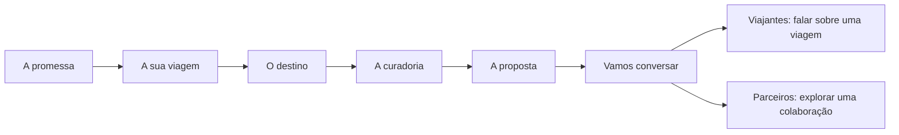

# Pitch BLU — viajar com intenção

Revisto em 28 de outubro de 2026. Público: viajantes, clientes empresariais e parceiros comerciais. A apresentação é um pitch da experiência de curadoria BLU, com um percurso comum e um encerramento ajustado ao objetivo do contacto.
Execução, navegação e testes: [guia da apresentação](../presentation/README.md).

## Mensagem central

**Conhecer quem viaja. Escolher com intenção. Construir uma experiência pessoal.**

A curadoria humana conduz a narrativa. A tecnologia apoia a preparação e revisão da proposta, sem substituir o diálogo com o cliente. O exemplo apresenta dois adultos, dois dias em Lisboa, ritmo tranquilo e exclusão de atividades de barco.

## Guião de cinco a sete minutos

A duração é uma sugestão editorial. Não há avanço automático nem obrigação de explorar todas as interações numa sessão comercial.

| Momento | Tempo sugerido | Mensagem e demonstração |
| --- | --- | --- |
| A promessa | 45 segundos | Portugal pode ser vivido de muitas formas. A BLU começa por compreender quem viaja. |
| A sua viagem | 45 segundos | Interesses e ritmo orientam o percurso. Escolher cultura ou gastronomia no exemplo. |
| O destino | 60 segundos | Dar significado às escolhas: uma descoberta, uma mesa e outro ponto de vista. Abrir um ponto do mapa. |
| A curadoria | 60 segundos | O plano constrói-se em conversa. Experimentar a segunda tarde livre e mostrar que o primeiro dia se mantém. |
| A proposta | 60 segundos | As escolhas tornam-se num percurso claro para rever. Relacionar o documento ilustrativo com o interesse e a tarde escolhidos. |
| Vamos conversar | 45–90 segundos | Selecionar viajantes ou parceiros e terminar com o próximo passo relevante. |

### A promessa

> Uma cidade pode ser vivida de muitas formas. Começamos por conhecer as pessoas
> para dar sentido às escolhas que fazem parte da sua viagem.

Apresentar os três pilares: escuta, curadoria e cuidado. A abertura não exige explicar o software nem introduzir uma lista de funcionalidades.

### A sua viagem

> Imagine dois dias em Lisboa, sem pressa. O que o faria sentir que esta viagem
> foi pensada para si: cultura e património, ou sabores e encontros?

Usar a escolha de interesse como convite ao público. Não recolher dados pessoais nem apresentar o caso fictício como uma encomenda real.

### O destino

> O valor está na ligação entre os lugares, o contexto e o que procura viver.

Mostrar uma possibilidade e a razão da sua presença no percurso. O mapa é esquemático; os pontos e as descrições não comprovam acesso, disponibilidade, preço ou reserva de uma experiência.

### A curadoria

> Uma proposta também precisa de espaço para mudar. Se preferir uma tarde livre,
> o percurso é revisto em conversa consigo.

A interação altera apenas o exemplo em memória. Explicar a revisão do curador, sem simular uma conversa de IA, confirmação de serviços ou automação de reservas.

### A proposta

> As escolhas ganham forma num percurso que podemos rever em conjunto antes de
> avançar para os detalhes e condições da viagem.

Apresentar a pré-visualização com o interesse e a tarde escolhidos. O documento é ilustrativo, não um PDF comercial emitido. Manter visível que preço,
disponibilidade e condições exigem confirmação.

## Encerramentos para os dois públicos

### Viajantes e clientes finais

**Mensagem:** a próxima viagem começa com uma conversa.

Pedir que partilhem interesses e expectativas com a BLU; conversar sobre as possibilidades e rever uma proposta adequada. O botão **Falar sobre a minha viagem** abre o WhatsApp com uma mensagem inicial que o visitante pode rever.

### Clientes empresariais e parceiros

**Mensagem:** explorar experiências com intenção para os seus clientes.

Convidar a conhecer o perfil dos clientes, explorar uma possível colaboração e definir o âmbito e os próximos passos. O botão **Conversar sobre uma parceria** abre o mesmo contacto público com outro texto inicial. Não pressupor uma parceria já estabelecida, condições acordadas, comissões ou níveis de serviço.

Nenhum botão envia automaticamente uma mensagem. O pitch não transmite as escolhas fictícias, não capta contactos e não regista eventos comerciais.

## Conteúdo retirado do percurso comercial

Arquitetura, frameworks, versões, ETL, infraestrutura, hashes, contagens de testes e simulações de falha pertencem à documentação técnica, não ao pitch.
Consultar [Arquitetura](ARCHITECTURE.md), [Decisões](DECISIONS.md), [Dados](DATA_PIPELINE.md), [Portal](PORTAL.md) e [Testes](TESTING.md).

O contexto académico, os nomes da equipa e a data de avaliação saíram do ecrã comercial; a evolução e proveniência permanecem no Git. Soft/Classic/Signature não são apresentados como produtos comerciais sem validação da BLU.
A comparação de versões e o Prompt TXT também não fazem parte desta narrativa.

Não anunciar ganhos percentuais, testemunhos, clientes, parcerias, preços ou resultados que não tenham sido medidos ou aprovados. O pitch não comprova prontidão operacional nem substitui a aceitação dos serviços reais.

## Demonstração operacional complementar

Uma demonstração do portal pode ser preparada separadamente para uma reunião que o justifique. Não é necessária para completar o pitch e não é aberta pelos botões comerciais. O portal no proxy do SageMaker exige a sessão adequada.
O [guião E2E](DEMO_E2E.md) cobre o fluxo de concierge, eventos e seguimento; [Operações](OPERATIONS.md) conserva os critérios de aceitação e as pendências.
