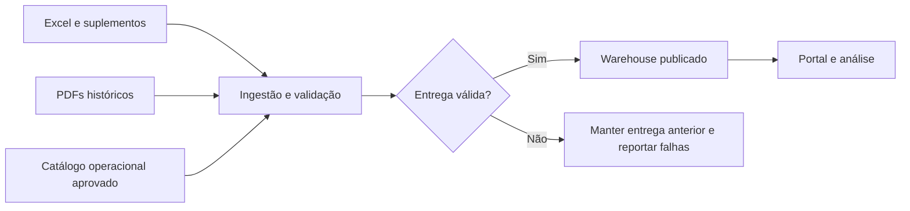
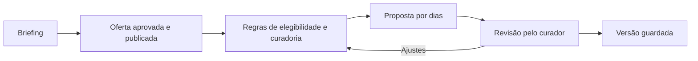
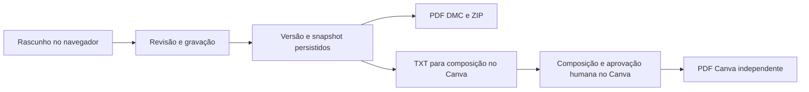
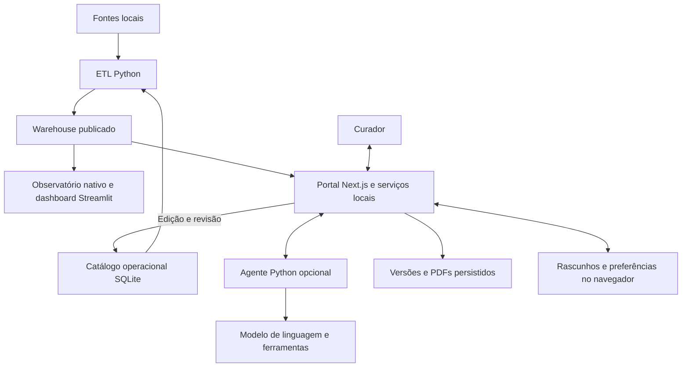

# BLU AI System — da informação à proposta de viagem

Proposta de narrativa e guião para uma apresentação interativa.
Preparado em 18 de outubro de 2026, no branch `apresentacao-interativa`.
O guião completo descreve a proposta de apresentação. Um primeiro protótipo
independente de três cenas está implementado em [presentation/](../presentation/README.md),
com exemplos fictícios, sem integração com o portal em execução.

## 1. A ideia central

**Mostrar como o conhecimento da BLU se transforma numa proposta personalizada,
com fontes consultáveis, regras explícitas e revisão do curador.**

A apresentação deve acompanhar uma viagem do princípio ao fim. O público
conhece primeiro o pedido do cliente e descobre cada componente quando ele
resolve uma necessidade concreta. A arquitetura aparece depois da demonstração,
quando já existe contexto para a compreender.

Frase de abertura sugerida:

> Um cliente pede uma viagem à medida. Como usamos o conhecimento da BLU para
> construir uma proposta que possamos explicar, rever e entregar?

Frase de fecho sugerida:

> O resultado é uma proposta personalizada cujo conteúdo podemos consultar,
> cuja evolução podemos acompanhar e cujas pendências continuam visíveis.

Público de referência: avaliação académica e responsáveis da operação.
Duração principal: **12 minutos**, com aprofundamentos disponíveis para perguntas.

## 2. Como faria o formato

Criaria uma **mesa de curadoria digital**, com o estilo do portal: azul-petróleo,
tipografia editorial, apontamentos dourados e escolha entre tema claro e escuro.
Uma aplicação no navegador, com capítulos ligados por uma linha de progresso.

Cada capítulo teria uma pergunta, uma demonstração visual e uma conclusão curta.
O apresentador controlaria o avanço; mapas e diagramas só ganhariam movimento
quando ajudassem a explicar uma transformação.

```text
┌────────────────────────────────────────────────────────────────────┐
│ blu.   O pedido → Os dados → O território → A proposta → A entrega │
├────────────────────────────────────────────────────────────────────┤
│                                                                    │
│  Uma pergunta                       Uma prova visual               │
│  O que precisa este cliente?        Briefing / mapa / roteiro       │
│                                                                    │
│  Uma frase-chave                    Um detalhe que se pode abrir   │
│                                     Fonte, regra ou versão         │
│                                                                    │
├────────────────────────────────────────────────────────────────────┤
│  Capítulo 1 de 8        [Anterior] [Seguinte]    [Explorar sistema]  │
└────────────────────────────────────────────────────────────────────┘
```

Haveria dois percursos sobre o mesmo conteúdo:

- **Guiado:** sequência preparada para os 12 minutos, com estados de demonstração.
- **Exploratório:** acesso direto à arquitetura, qualidade, IA e versões nas
  perguntas finais.

Os estados preparados usariam dados fictícios e seriam identificados como
**simulação**. Uma demonstração ao vivo seria identificada como **sistema local**.
Capturas ou gravações de apoio teriam data. Estes estados visuais são uma proposta
para a futura apresentação e não descrevem controlos já existentes.

As animações seriam discretas, com alternativa sem movimento. Haveria navegação
por teclado, texto legível à distância e diagramas compreensíveis mesmo sem
animação. Uma versão HTML autónoma com capturas permitiria apresentar sem
internet; o funcionamento completo do portal exige os seus serviços e dados.

## 3. O percurso de 12 minutos

| Capítulo | Tempo | Pergunta que orienta a cena | O que mostrar | Mensagem a deixar |
| --- | --- | --- | --- | --- |
| 1. O pedido | 1 min | O que torna esta viagem particular? | Um cartão com o cliente fictício e três necessidades | A personalização começa com informação estruturada |
| 2. O conhecimento | 1 min 30 s | Como tornam os dados utilizáveis? | Fontes → validação → catálogo publicado | A qualidade da proposta começa na qualidade das fontes |
| 3. O território | 1 min 30 s | Que oferta conhecemos e com que confiança? | Observatório, mapa, filtros e evidência | Análise e contexto apoiam a escolha |
| 4. A proposta | 3 min | Como passamos do pedido ao itinerário? | Briefing, geração, dias, regras e pendências | A proposta respeita critérios e continua editável |
| 5. A colaboração | 1 min 30 s | Como ajuda o assistente? | Uma alteração explícita e uma atividade protegida | A assistência trabalha dentro de contratos e limites |
| 6. A entrega | 1 min 30 s | O que foi guardado e o que é entregue? | Versões, PDF e opção TXT/Canva | A entrega corresponde a uma versão identificável |
| 7. O sistema | 1 min | Como se ligam as peças? | Esquema de arquitetura com os fluxos destacados | Cada componente tem uma responsabilidade definida |
| 8. O próximo passo | 1 min | O que está demonstrado e o que falta? | Estado atual, avaliação e evolução | A maturidade é apresentada com evidência |

**Total: 12 minutos.** Nas perguntas, aprofundar os capítulos sem repetir o percurso.

## 4. O caso que liga a história

Usar um exemplo fictício e consistente ao longo da apresentação:

| Campo | Exemplo de demonstração |
| --- | --- |
| Identificação | Grupo Demonstração BLU |
| Destino e duração | Lisboa, dois dias |
| Participantes | Dois adultos |
| Interesses | Cultura, património e gastronomia |
| Ritmo | Descontraído, com início tardio |
| Orçamento | 600 EUR, como referência do briefing |
| Necessidade a verificar | Reduzir distâncias a pé |
| Exclusão | Evitar atividades de barco |

A necessidade de reduzir caminhadas deve levar a uma verificação explícita de
compatibilidade. Se não existir informação suficiente, mostrar a pendência ou a
ausência de oferta elegível. Escolher as datas depois de confirmar a oferta
publicada para a demonstração. O orçamento do briefing não prova que todos os
custos são conhecidos ou que o total será cumprido.

Preparar uma versão guardada de apoio para este exemplo, num ambiente de
demonstração isolado. Não usar propostas ou contactos de clientes reais.

## 5. O que é importante contar em cada capítulo

### Capítulo 1 — Um pedido com critérios

Apresentar o cliente em cerca de três frases, dando destaque ao destino, ao
ritmo e às necessidades que podem alterar as escolhas.

Mostrar como preferências, restrições e exclusões têm efeitos diferentes.
Um interesse pode ajudar a ordenar a oferta; uma restrição exige compatibilidade
sustentada; uma exclusão impede uma escolha.

Pergunta para envolver o público: **«Que informação ainda precisamos de confirmar
antes de propor esta experiência?»**

### Capítulo 2 — Dos ficheiros ao conhecimento utilizável

Mostrar uma fonte de cada tipo, sem percorrer pastas ou folhas extensas:
Excel, suplemento estruturado e PDF histórico. Explicar que o ETL organiza e
valida a entrega, preservando origem e relações.



Três aspetos a tornar visíveis:

- A origem de um dado pode ser consultada.
- Informação histórica conserva o seu contexto temporal.
- Editar o catálogo e publicar uma entrega são etapas distintas.

**Exemplo visual:** acompanhar um registo desde a fonte até à ficha consultada.
Se houver uma divergência real no exemplo preparado, mostrar como é assinalada,
sem inventar um conflito apenas para preencher a cena.

### Capítulo 3 — Explorar o território

No Catálogo, abrir o Observatório interativo e seguir um percurso curto:
mapa → destino → oferta → ficha → informação de qualidade.

As seis áreas disponíveis são Panorama, Explorar oferta, Destinos, Preços,
Histórico e Qualidade. Mostrar apenas duas ou três durante a narrativa; deixar
as restantes para exploração.

Pontos de valor:

- Conhecer a distribuição da oferta por destino e tipo.
- Abrir um ponto do mapa e chegar a um registo identificável.
- Comparar ofertas mantendo unidades, moedas e condições explícitas.
- Distinguir informação conhecida, pendente, histórica ou expirada.

Usar indicadores da entrega consultada no dia e registar a data da captura.
O número de registos mede cobertura do catálogo, não reservas ou desempenho
comercial. O Observatório nativo lê a entrega publicada; a aplicação analítica
Streamlit original continua separada.

### Capítulo 4 — Construir uma proposta que se pode rever

Preencher apenas o essencial do briefing e avançar para a proposta. Mostrar um
dia em detalhe: atividades, horários propostos, deslocações, custos conhecidos
e verificações ainda necessárias.



Escolher **um exemplo de decisão explicável**: uma oferta incluída por adequação
aos interesses, uma opção excluída ou uma lacuna por falta de informação.
Apresentar o que efetivamente acontecer no caso preparado.

Mostrar uma pendência como parte do trabalho operacional. A proposta não confirma
automaticamente preço, disponibilidade ou condições do fornecedor. Horários e
percursos precisam de revisão. Totais conhecidos e pendências devem aparecer
separados, conservando as moedas.

### Capítulo 5 — O papel da IA e da revisão humana

Distinguir claramente os mecanismos presentes:

| Mecanismo | Papel no sistema | O que demonstrar |
| --- | --- | --- |
| Regras e lógica determinística | Elegibilidade, curadoria, validação e comandos suportados | O efeito de uma regra e de um comando explícito |
| Agente de linguagem opcional | Interação através de modelo e ferramentas de catálogo, meteorologia e restrições | Uma resposta fundamentada, se o serviço estiver disponível e autorizado |
| Curador humano | Rever escolhas, resolver pendências e preparar a entrega | Uma decisão de aceitação, alteração ou confirmação |

O código do agente usa LangChain/LangGraph e pode usar modelos via AWS Bedrock.
O portal também funciona sem esse serviço. Não apresentar um comando
determinístico como prova de que um modelo de linguagem foi executado.
A disponibilidade do serviço e a autorização de eventuais custos devem ser
confirmadas antes de preparar uma demonstração com chamadas reais.

Demonstração sugerida: pedir **«adicionar tarde livre ao dia 1»** numa proposta
preparada e observar a alteração. Depois, mostrar uma atividade protegida e
explicar o limite aplicável. Se for demonstrado um pedido incompatível, confirmar
antes qual a mensagem e o comportamento reais do fluxo.

Mensagem oral: **«A assistência apoia decisões sobre um catálogo conhecido;
a validação e o curador continuam presentes.»**

### Capítulo 6 — Da edição à entrega

Mostrar a ligação entre o que foi revisto, a versão guardada e o documento
exportado. Evitar gastar tempo a abrir sucessivos formatos.



Abrir um PDF DMC e mostrar a organização do roteiro. Explicar que as versões
preservam o conteúdo e os PDFs históricos. Uma edição posterior não reescreve
uma entrega já guardada.

O TXT/Canva parte da versão guardada e exclui contactos e notas internas.
A composição Canva e o seu PDF são uma entrega independente; não atualizam
automaticamente o PDF DMC. A tradução de conteúdos exportados usa modelos locais
quando estão preparados. A interface tem seis idiomas.

### Capítulo 7 — A arquitetura em um minuto

Apresentar primeiro os fluxos e só depois os nomes das tecnologias.



O portal usa lógica de domínio em TypeScript e operações locais em Python.
O catálogo operacional, o warehouse, os rascunhos e as versões têm funções
próprias. O diagrama é uma visão funcional resumida, não um desenho de deployment
cloud ou uma descrição exaustiva das chamadas entre módulos.

### Capítulo 8 — Evidência e evolução

Separar três tipos de afirmação:

| Estado | Exemplos que podemos apresentar |
| --- | --- |
| Implementado | Catálogo editável, publicação ETL, Observatório, briefing, proposta, edição, versões e exportação |
| Dependente do ambiente | Agente de linguagem, modelos de tradução, fontes CJK e fornecedores de rotas/meteorologia |
| Evolução a preparar | Autenticação e papéis, sincronização multiutilizador, persistência cloud e revisão da partilha externa |

Os testes cobrem regras, contratos, persistência e interface. Nos últimos registos
locais de 18 de outubro de 2026 constam 97 testes Node aprovados, um ignorado e
54 combinações de interface/navegação aprovadas. Os cenários de interface usam
simulações em APIs aplicáveis. Estes números são evidência técnica localizada;
não são uma avaliação de qualidade comercial ou uma certificação de produção.
Consultar o [registo de testes](TESTING.md) e o [plano](../PLAN.md) antes de os citar.

Apresentar os ganhos de rapidez, consistência e facilidade de revisão como
**hipóteses a medir**. Uma avaliação útil compararia a mesma tarefa com e sem o
sistema: tempo até à primeira proposta revista, erros de compatibilidade,
pendências detetadas e avaliação dos curadores. Definir a amostra e os critérios
antes de recolher resultados.

## 6. O que deve ficar claro nas perguntas

| Pergunta provável | Base para responder |
| --- | --- |
| Onde está a IA? | No agente opcional e nas suas ferramentas; distinguir os fluxos determinísticos |
| De onde vem cada sugestão? | Catálogo publicado, origem consultável e critérios aplicados |
| Como evitam informação inventada? | Oferta conhecida, validações, evidência e manutenção explícita de desconhecidos; a revisão humana continua necessária |
| O sistema faz reservas? | Produz propostas; não efetua reservas |
| Os preços são atuais? | Dependem da evidência e validade de cada registo; histórico não prova tarifa atual |
| Duas pessoas podem trabalhar como numa aplicação colaborativa? | A sincronização multiutilizador e os papéis ainda precisam de desenvolvimento |
| O cliente pode abrir um link fora do Studio? | O acesso externo exige validação e configuração próprias; uma ligação no Studio não demonstra acesso público |
| Foi treinado um modelo novo? | Este fluxo integra modelos e ferramentas existentes; não apresentar treino próprio sem evidência |
| Que resultado foi medido? | Distinguir testes técnicos, demonstração local e avaliação com curadores |

## 7. Preparação da demonstração

Antes da sessão:

- Preparar um briefing fictício e uma proposta de apoio em armazenamento isolado.
- Confirmar a entrega publicada e a oferta elegível para o exemplo escolhido.
- Ensaiar o pedido ao assistente e as restrições com o estado preparado.
- Confirmar os serviços necessários; usar gravação identificada se um depender
  de rede ou autorização que não estará disponível.
- Preparar um PDF de exemplo e uma captura datada dos indicadores.
- Testar teclado, tamanho do texto, tema e projeção no ecrã da sala.
- Remover dados pessoais, notificações e segredos das superfícies apresentadas.
- Ensaiar o percurso de 12 minutos e o regresso ao guião depois de uma pergunta.

Se uma dependência falhar durante a apresentação, explicar o estado e continuar
com a versão guardada ou a gravação identificada. Não substituir uma falha por
um resultado simulado sem o dizer.

## 8. Próximo passo para construir a apresentação

O protótipo de três capítulos — **o pedido, o território e a proposta** — já
está implementado como aplicação estática independente. O próximo passo é
validar o ritmo e a legibilidade com alguém que não conhece o sistema. Depois,
acrescentar entrega, arquitetura e aprofundamentos.

O protótipo deve ligar uma necessidade do cliente a uma escolha observável no
roteiro. Esse encadeamento será o fio condutor de toda a apresentação.

## Fontes internas para aprofundamento

- [Arquitetura e contratos](ARCHITECTURE.md)
- [Funcionalidades e execução do portal](PORTAL.md)
- [Pipeline e publicação dos dados](DATA_PIPELINE.md)
- [Testes e limites das validações](TESTING.md)
- [Decisões e evolução](DECISIONS.md)
- [Comandos, contexto académico e limites](../README.md)
- [Leitura do Observatório](../portal/observatory.py)
- [Comandos determinísticos do assistente](../dmc-workspace/src/lib/assistant-editing.ts)
- [Agente de linguagem e ferramentas](../src/blu_ai/agents/curator_agent.py)
