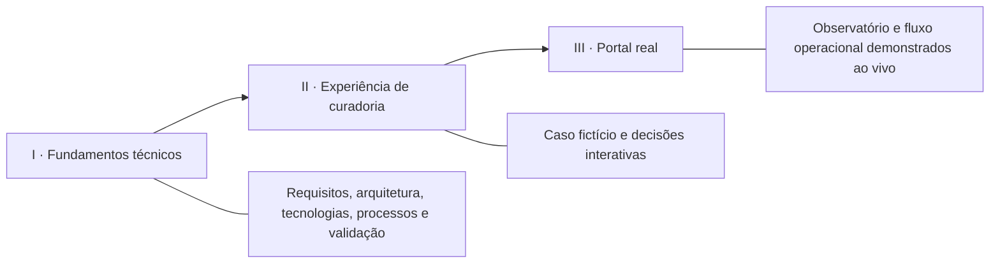
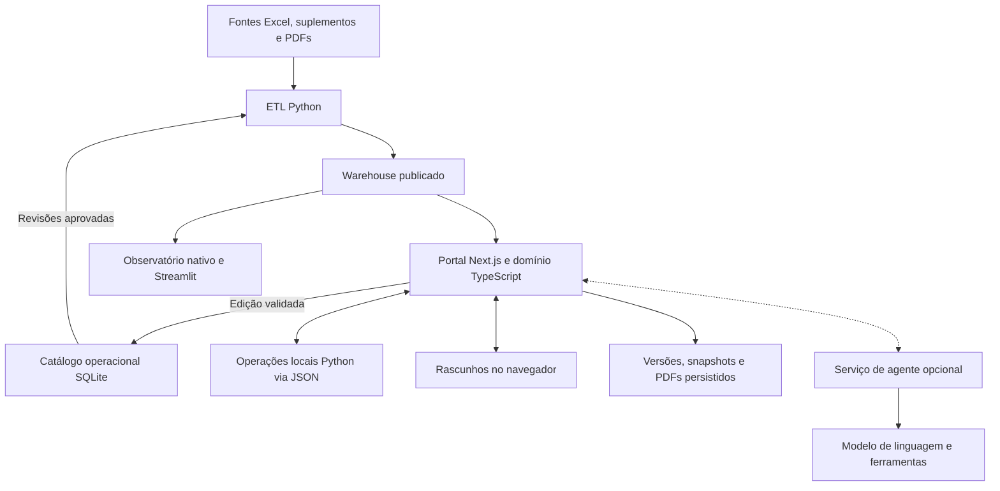
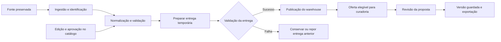
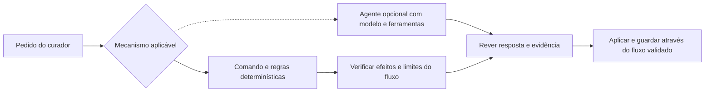

# BLU AI System — fundamentos, experiência e portal

Guião revisto em 20 de outubro de 2026.
Público de referência: avaliação académica e responsáveis da operação.

A apresentação passa a ter **três partes: explicar como o sistema foi construído,
mostrar como as peças criam valor e demonstrar o portal real**.

Estado atual: a [apresentação independente](../presentation/README.md) inclui
seis cenas técnicas e seis cenas narrativas. Há navegação entre
as partes e animações explicativas controláveis. O acesso ao portal abre um
novo separador; o portal e o dashboard analítico continuam separados.

## 1. Estrutura e mensagem central

**O sistema transforma conhecimento disperso numa proposta personalizada,
consultável, revista pelo curador e associada a uma versão identificável.**



A parte I responde a **«Como e porquê foi construído desta forma?»**.
A parte II responde a **«O que significa isso para uma viagem concreta?»**.
A parte III responde a **«Como funciona na aplicação real?»**.

Proposta de duração, a ajustar ao tempo atribuído:

| Parte | Percurso principal | Versão curta |
| --- | --- | --- |
| I. Fundamentos técnicos | 8 minutos | 4 minutos |
| II. Experiência interativa | 5 minutos | 3 minutos |
| III. Portal real | 7 minutos | 5 minutos |
| Total, sem perguntas | 20 minutos | 12 minutos |

O tempo é uma proposta de guião, não um requisito já acordado. Os
aprofundamentos devem ficar acessíveis para perguntas, sem interromper o fio.

## 2. Parte I — os pontos técnicos a abordar

### 2.1. Problema, utilizadores e âmbito

Começar pela necessidade operacional e só depois apresentar a solução:
conhecimento em Excel, suplementos e PDFs; necessidade de o organizar,
consultar, rever e usar na preparação de propostas personalizadas.

Identificar o **curador** como utilizador principal do portal. Distinguir o
trabalho de quem mantém e aprova o catálogo da análise e da preparação da
proposta, sem sugerir que já existe gestão de papéis na aplicação.

Explicar o âmbito: o sistema prepara e entrega propostas; disponibilidade,
condições e reservas exigem processos próprios. Autenticação e colaboração
multiutilizador continuam a ser evolução a desenvolver.

**Visual sugerido:** fontes dispersas convergem num fluxo de curadoria.
**Mensagem oral:** «Definimos o que o sistema deve apoiar e onde continua a ser
necessária uma decisão humana.»

### 2.2. Requisitos funcionais e requisitos de qualidade

Mostrar requisitos ligados a comportamentos observáveis, com critérios de
aceitação que possam ser demonstrados.

| Tipo | Requisito a apresentar | Como o tornar verificável |
| --- | --- | --- |
| Funcional | Consultar e manter o catálogo | Abrir um registo, consultar origem e histórico de revisão |
| Funcional | Criar propostas adequadas ao briefing | Relacionar uma preferência ou exclusão com uma escolha no roteiro |
| Funcional | Respeitar restrições e atividades protegidas | Mostrar uma alteração válida e um pedido que não pode ser aplicado |
| Funcional | Guardar, reabrir e exportar versões | Relacionar o conteúdo revisto com a versão e o documento selecionados |
| Qualidade | Preservar rastreabilidade e contexto temporal | Distinguir fonte, evidência, data e informação histórica |
| Qualidade | Preservar integridade e concorrência | Demonstrar num cenário de teste a rejeição de uma revisão desatualizada |
| Qualidade | Tratar informação desconhecida explicitamente | Mostrar preço pendente sem o converter em zero, ou compatibilidade por confirmar |
| Qualidade | Manter legibilidade e interação responsiva | Verificar tamanhos de ecrã, teclado, foco e idiomas |
| Evolução | Autenticação, papéis e colaboração multiutilizador | Apresentar como trabalho futuro, com critérios ainda a definir |

Evitar requisitos vagos como «ser inteligente», «ser rápido» ou «ser seguro».
Se forem discutidos desempenho ou segurança, indicar métricas e controlos
concretos, o âmbito avaliado e o que falta medir ou implementar.

### 2.3. Arquitetura e fronteiras de responsabilidade

Mostrar primeiro os fluxos, depois identificar as tecnologias. Explicar a
separação entre fontes, catálogo operacional, entrega publicada e propostas.



O diagrama é funcional: não representa todos os pedidos nem um deployment
completo. As operações locais Python e o serviço HTTP do agente têm fronteiras
distintas. O adaptador local usa processos sem shell e mensagens JSON; não exige
um segundo servidor para essas operações.

Quatro distinções essenciais:

- **Catálogo operacional:** edição, revisões e aprovações.
- **Warehouse:** entrega publicada e validada, consumida pela análise e portal.
- **Rascunhos:** estado de trabalho no navegador.
- **Versões:** snapshots e documentos históricos persistidos no servidor.

Uma alteração no catálogo não reescreve uma proposta já guardada. O portal não
edita diretamente o warehouse. Estas fronteiras explicam boa parte do desenho.

### 2.4. Tecnologias e justificação das escolhas

Apresentar cada tecnologia através da responsabilidade que tem no código.
A justificação abaixo é uma forma de explicar o desenho atual; não substitui
um levantamento de alternativas ou um benchmark, que não foi realizado aqui.

| Camada | Tecnologias declaradas no projeto | Papel e justificação a desenvolver |
| --- | --- | --- |
| Portal | Next.js, React, TypeScript, Tailwind CSS | Interface interativa, rotas de servidor e contratos do domínio |
| Ingestão e transformação | Python, pandas, openpyxl, pypdf | Leitura de folhas e documentos, transformação e validação das fontes |
| Dados | Amazon S3, SQLite, JSONL e ficheiros versionados | S3 como persistência permanente; cache transacional reconstruível para consulta e edição |
| Análise | Streamlit e Plotly; Observatório nativo em React/SVG | Exploração da entrega publicada com interfaces distintas |
| Agente opcional | FastAPI, LangChain/LangGraph, boto3 e AWS Bedrock | Serviço de assistência, modelo de linguagem e ferramentas de domínio |
| Tradução opcional | Argos Translate e CTranslate2 | Tradução local de conteúdos exportados, com proteção de números |
| Entregas | PDFKit e Prompt TXT | Produção de documentos e exportação estruturada independente de fornecedor |
| Verificação | unittest, node:test e Playwright | Testes de regras, persistência, integração e interface |
| Apresentação independente | HTML, CSS, JavaScript e servidor Python padrão | Narrativa demonstrativa na porta 3003, sem dependências de execução do portal |

Confirmar versões nos manifests antes da sessão: Python 3.12/3.13 e Node
22.13 a 24.x são os intervalos definidos neste checkout. Os manifests e os
lockfiles prevalecem sobre este resumo.

Distinguir também **onde corre** de **como foi construído**: o ambiente atual
usa SageMaker Studio Code Editor para execução e acesso. Isto não significa
que foi treinado um modelo próprio no SageMaker, nem que existe autenticação
interna do portal. O acesso do Studio e os papéis da aplicação são temas distintos.

### 2.5. Dados, modelos e processos de ponta a ponta

Seguir um registo ao longo do processo, em vez de mostrar uma lista de scripts.



Abordar estes aspetos com um exemplo por tema:

- **Identidade e relações:** IDs e chaves explícitas ligam registos e histórico;
  uma semelhança de nomes não prova uma correspondência.
- **Qualidade:** campos em falta, conflitos e evidência têm tratamento explícito.
- **Normalização:** destinos e unidades são harmonizados sem apagar as condições
  e o valor original. Informação desconhecida continua desconhecida.
- **Validade temporal:** um preço histórico ou expirado não passa a preço atual.
- **Publicação:** o ETL valida antes da troca e tem recuperação da entrega anterior.
- **Revisões:** aprovar, publicar e guardar uma proposta são operações distintas.
- **Custos:** separar valores conhecidos, pendências e totais por moeda.

O fluxo deve mostrar as releases imutáveis no S3, a cache temporária e o
checkpoint remoto do `just blu it`. Isto comprova persistência e recuperação no
ambiente atual; não equivale a deployment multi-instância de produção.

### 2.6. Papel da IA, ferramentas e controlo humano

Esta é uma distinção técnica central, sobretudo perante uma avaliação de IA.

| Mecanismo | O que faz | O que não se deve inferir |
| --- | --- | --- |
| Regras e comandos determinísticos | Elegibilidade, critérios de curadoria e alterações suportadas | Uma resposta no chat não prova que um LLM foi chamado |
| Agente de linguagem opcional | Usa modelo e ferramentas de pesquisa do catálogo, meteorologia e restrições | A existência do código não comprova disponibilidade ou execução do fornecedor |
| Modelos locais de tradução | Traduzem conteúdos exportados quando preparados | Tradução não confirma os factos ou condições comerciais |
| Revisão humana | Resolve pendências, revê a proposta e prepara a entrega | Uma proposta gerada não equivale a uma reserva confirmada |



O esquema mostra a separação de responsabilidades a explicar; não afirma que
qualquer resposta livre do agente seja convertida automaticamente numa ação.
Mostrar a chamada e o comportamento concretos do fluxo escolhido.

Explicar a consulta ao catálogo conhecido e as ferramentas realmente presentes.
Não apresentar fine-tuning, pesquisa vetorial, RAG com embeddings ou treino
próprio como funcionalidades implementadas sem evidência no código.

A demonstração atual tem respostas preparadas e assinaladas como simulação.
Para uma chamada real, confirmar serviço, modelo configurado e autorização de
custos antes da sessão. Conteúdos de PDFs, clientes e respostas externas são
dados; não devem ser tratados como instruções do sistema.

### 2.7. Validação, evidência e limitações

Mostrar **o que os testes protegem**, com exemplos concretos:

| Fronteira | Comportamento a verificar | Referência no repositório |
| --- | --- | --- |
| Publicação ETL | Falha de construção conserva a entrega; falha na troca repõe a anterior | [test_local_source.py](../tests/test_local_source.py) |
| Catálogo e publicação | Revisões e estado publicado condicionam a oferta elegível | [catalog.test.mjs](../dmc-workspace/tests/catalog.test.mjs) |
| Versões | Escritas desatualizadas são rejeitadas; snapshots e bytes históricos são preservados | [versions.test.mjs](../dmc-workspace/tests/versions.test.mjs) |
| Informação desconhecida | Ausências e zero não são confundidos na análise | [test_portal_observatory.py](../tests/test_portal_observatory.py) |
| Interface | Navegação, foco, dimensões e texto ampliado | [ui.mjs](../dmc-workspace/tests/browser/ui.mjs) |
| Tradução | Números protegidos, falhas e modelos ausentes | [test_worker.py](../translations/test_worker.py) |

Distinguir resultados de testes unitários, integração com dados temporários,
interface com APIs simuladas e serviços externos reais. Uma bateria aprovada
não prova, por si só, adequação comercial ou prontidão para produção.

Se forem usados números, apresentar data, ambiente e âmbito da execução. O
[guia de testes](TESTING.md) explica o que cada bateria valida; resultados
transitórios não devem ser apresentados como estado permanente.

Fechar com os limites atuais: o login local do Monitoring não autentica o portal;
identidade, papéis, sincronização multiutilizador, hosting de produção e acesso
externo continuam por definir. Ganhos de
rapidez, consistência e qualidade devem ser avaliados com curadores; não
atribuir percentagens sem medições.

### 2.8. Seis cenas técnicas, com aprofundamento opcional

| Cena | Tempo sugerido | Conteúdo principal | Interação |
| --- | --- | --- | --- |
| T1. Requisitos | 1 min | Necessidade e comportamento verificável | Selecionar personalização, rastreabilidade, integridade ou continuidade |
| T2. Arquitetura | 1 min 30 s | Camadas e fronteiras | Explorar um componente e as suas ligações |
| T3. Tecnologias | 2 min | Dependências e implementação | Escolher uma área e abrir os detalhes relevantes |
| T4. Dados e processos | 1 min 30 s | Da fonte à versão | Avançar o registo e ilustrar a falha de publicação |
| T5. Papel da IA | 1 min | Mecanismos distintos | Comparar regras, agente e tradução |
| T6. Validação e limites | 1 min | Contratos e evidência | Explorar números na tradução, conflitos e interface |

**Total proposto: 8 minutos.** As seis cenas estão implementadas, sem chamadas
a modelos, publicação de dados ou execução implícita de testes. Os efeitos
visuais podem ser desativados pelo botão ou pela preferência de movimento reduzido.

No capítulo Tecnologias, não percorrer todos os detalhes durante o guião
principal. Escolher duas áreas que melhor respondam à audiência e reservar
as restantes para perguntas. O inventário está em
[technology-content.js](../presentation/dist/technology-content.js), separado da
lógica de navegação para facilitar a complementação posterior.

### 2.9. Detalhes de implementação agora disponíveis

| Área | Detalhe acrescentado | Evidência e limite |
| --- | --- | --- |
| Portal e integração | Versões declaradas, renderização e divisão cliente/servidor, JSON por stdin/stdout, execução sem shell, timeout de 15 s e buffer de 16 MiB | `package.json` e `python-portal.ts`; não é um teste de latência |
| Ingestão e dados | Papel de pandas/openpyxl/pypdf, chaves, conflitos, entidades, manifest, SHA-256 e publicação temporária | Código ETL e contratos; não inventariar volumes sem uma entrega datada |
| Persistência e entregas | Releases S3, cache SQLite, fila JSON, warehouse, snapshots, hashes e PDF/ZIP/TXT | Código de persistência e recuperação; não equivale a colaboração multi-instância |
| Agente e ferramentas | FastAPI/Uvicorn, LangGraph/LangChain, boto3/Bedrock, ferramentas e configuração do modelo | Modelo/região efetivos por confirmar; temperatura 0,2 e 4096 tokens são defaults do código |
| Análise e tradução | Streamlit/Plotly, Observatório React/SVG em leitura, worker JSON-lines e modelos Argos/CTranslate2 | Grupos opcionais; não presumir disponibilidade por existir uma dependência |
| Serviços externos | Open-Meteo e OSRM, timeout/aborto, previsão/histórico, cache e falhas explícitas | Comportamentos do código; sem chamadas reais nesta apresentação |
| Ambiente e automação | `uv.lock`, `package-lock.json`, testes, CI de dados/documentação e acesso SageMaker | Não há workflow CI do portal neste checkout; sem certificação de produção |

As versões exibidas são as declaradas nos manifests, e não uma listagem de
bibliotecas atualmente instaladas ou serviços em execução. Os limites do código
não são apresentados como resultados de desempenho. A justificação histórica das
escolhas e a comparação de alternativas precisam da informação da equipa.

Frase de passagem para a parte II:

> Já vimos os contratos e as peças. Vamos agora acompanhar uma viagem e perceber
> como essas decisões de engenharia aparecem na experiência do curador.

## 3. Parte II — transição entre engenharia e experiência

Reutilizar a apresentação interativa existente. O público acompanha um caso
fictício e vê os efeitos das escolhas, sem precisar de voltar a ouvir a descrição
de cada tecnologia.

Percurso guiado sugerido, usando os capítulos já disponíveis:

| Cena existente | Papel na transição |
| --- | --- |
| O pedido | Dar rosto aos requisitos através de dois adultos e dois dias em Lisboa |
| O território | Explorar possibilidades e contexto num mapa esquemático |
| A proposta | Relacionar o interesse escolhido com o roteiro e ajustar uma tarde livre |
| A colaboração | Mostrar uma alteração permitida e o limite de uma atividade protegida |
| A entrega | Comparar exemplos de versões e ligar revisão à entrega |
| O próximo passo | Encerrar a simulação e abrir o Observatório real |

As cenas **Os dados** e **Por dentro** foram retiradas da parte II: os seus
conteúdos pertencem à arquitetura e aos processos da parte I. A entrega mostra
as escolhas do grupo e a comparação do exemplo, em vez de repetir tecnologias
e formatos. O acesso ao portal fica no encerramento e no controlo global.

Caso comum: Grupo Demonstração BLU, dois adultos, dois dias em Lisboa, ritmo
tranquilo, cultura ou gastronomia e exclusão de atividades de barco. O exemplo
deve manter-se consistente nas três partes. Necessidades de mobilidade exigem
verificação explícita; se faltar informação, mostrar a pendência.

O mapa, as ofertas, as respostas e a pré-visualização de versões nesta
apresentação são ilustrativos. Não são leituras em direto do catálogo, geração
por IA, versões persistidas ou PDFs exportados.

Frase de passagem para a parte III:

> Esta experiência mostrou o percurso com um exemplo preparado. Vamos agora
> abrir a aplicação e consultar a informação real que suporta o trabalho.

## 4. Parte III — demonstração do portal real

O ecrã final mantém o botão **Explorar o Observatório real**, que abre um
novo separador com o endereço indicado pelo utilizador:

[Explorar o Observatório real](https://ai5qwwdt6siuxug.studio.eu-west-1.sagemaker.aws/codeeditor/default/ports/3001/)

O acesso depende da sessão SageMaker do visitante. O endereço não é um link
público para clientes externos. Renovar o acesso antes da apresentação e manter
a apresentação aberta para poder regressar ao guião.

Demonstração sugerida, com um caso previamente preparado:

1. **Observatório:** filtrar um destino, abrir a ficha e mostrar contexto,
   qualidade ou uma pendência. Os indicadores pertencem à entrega consultada;
   registar a data se forem usados em capturas.
2. **Workspace:** relacionar os campos do briefing com uma proposta de demonstração
   e explicar uma escolha, exclusão ou informação por confirmar.
3. **Revisão:** mostrar uma edição suportada ou uma atividade protegida,
   distinguindo comandos determinísticos de eventuais chamadas ao agente.
4. **Entrega:** abrir uma versão de demonstração e o seu PDF, mostrando a ligação
   entre snapshot e documento. Explicar o Prompt TXT como exportação independente.

O Observatório nativo tem Panorama, Explorar oferta, Destinos, Preços, Histórico
e Qualidade; escolher apenas as vistas relevantes para a história. A aplicação
Streamlit original continua separada. A interface do portal tem seis idiomas;
a tradução de conteúdos exportados depende dos modelos locais preparados.

Usar dados fictícios e armazenamento de demonstração para os fluxos com escrita.
Preparar o cenário antes da sessão para não alterar catálogo, aprovações ou
propostas de clientes durante uma demonstração improvisada. O sistema produz
propostas, não efetua reservas nem confirma automaticamente condições comerciais.

## 5. Linguagem visual e navegação

Manter a identidade da mesa de curadoria: azul-petróleo, tipografia editorial,
apontamentos dourados e transições com significado. Cada cena deve ter uma
pergunta, uma prova visual e uma conclusão curta.

```text
┌────────────────────────────────────────────────────────────────────┐
│ blu.      I · Fundamentos     II · Experiência     III · Portal ↗   │
├────────────────────────────────────────────────────────────────────┤
│ Capítulos da parte selecionada                                     │
│                                                                    │
│ Uma pergunta                  Um diagrama ou interação              │
│ Uma mensagem principal        Responsabilidade / estado / evidência │
│                                                                    │
├────────────────────────────────────────────────────────────────────┤
│ Parte I · 2/5              [Anterior] [Seguinte / Entrar na parte II]│
└────────────────────────────────────────────────────────────────────┘
```

A navegação de três partes está implementada neste branch. A terceira parte
abre o portal, sem o incorporar num iframe nem alterar os seus serviços.

Dar acesso direto às partes para perguntas e para uma apresentação mais curta.
O avanço é manual; manter teclado, foco visível e alternativa sem movimento.
Evitar código extenso no ecrã: usar um excerto curto apenas quando fundamenta
uma decisão importante. Referências detalhadas ficam disponíveis no guião.

## 6. Perguntas a preparar

| Pergunta | Ponto de resposta |
| --- | --- |
| Porque separam catálogo e warehouse? | Revisão operacional e entrega publicada têm responsabilidades e ciclos próprios |
| Porque usam Python e TypeScript? | Explicar os papéis que têm no código e a fronteira JSON, sem alegar um benchmark inexistente |
| O que acontece se a publicação falhar? | Preparação temporária, validação e conservação ou recuperação da entrega anterior |
| Onde está a IA? | Distinguir agente opcional, comandos determinísticos e tradução local |
| Como avaliam respostas ou propostas? | Testes de contratos e uma avaliação com curadores a definir; distinguir qualidade técnica de comercial |
| Como evitam factos inventados? | Catálogo conhecido, fontes, validações, pendências e revisão humana; não prometer ausência total de erros |
| Como resolvem alterações concorrentes? | Revisões e conflitos; isso não equivale a sincronização colaborativa completa |
| O que falta para produção? | Identidade, papéis, persistência e operação cloud, acesso externo e avaliação no contexto de uso |

## 7. Preparação e próximos passos

- Ensaiar as seis cenas técnicas e a navegação das três partes já implementadas
  na aplicação independente, mantendo os serviços do portal inalterados.
- Ensaiar o percurso e a duração com alguém que não conhece o sistema.
- Confirmar versões, fontes e evidência antes de mostrar números ou resultados.
- Preparar a sessão SageMaker, o caso fictício e uma versão de apoio para o portal.
- Identificar claramente simulações, capturas datadas e demonstrações reais.
- Confirmar serviços opcionais e autorização antes de qualquer chamada com custos.
- Preparar capturas ou gravação de apoio, sem apresentar uma gravação como execução
  ao vivo se uma dependência falhar.

## 8. Informação a complementar mais tarde

Esta revisão não exige que a equipa responda já. A matriz identifica o que
falta e onde integrar essa informação quando estiver disponível.

| Informação por confirmar | O que sabemos pelo código | Complemento a fornecer | Onde integrar |
| --- | --- | --- | --- |
| Requisitos acordados com utilizadores | Existem campos, regras e fluxos implementados | Prioridades, critérios de aceitação e validação com curadores | Requisitos |
| Escolhas de arquitetura e tecnologias | Dependências e responsabilidades são verificáveis | Alternativas consideradas, razões e compromissos da equipa | Tecnologias e notas do apresentador |
| Modelo e região usados | Configuração por ambiente e caminho Bedrock | Modelo efetivo, parâmetros da sessão, permissões e motivo da seleção | Agente e ferramentas |
| Caracterização do dataset | Fontes, entidades e contratos estão identificados | Volumes com data, cobertura, origem/licença e limites da amostra | Ingestão e dados |
| Avaliação da qualidade | Existem testes de contratos e interface | Casos avaliados, rubrica, respostas revistas e parecer de curadores | Validação |
| Desempenho e custos | Há timeouts, limites e mecanismos de falha | Latência, número de chamadas, tokens/custos e condições de medição | Validação e dependências |
| Processo de desenvolvimento | Git, lockfiles e workflows existentes | Etapas, divisão do trabalho e decisões tomadas pela equipa | Ambiente/automação |
| Operação futura | Execução Studio, S3 e checkpoints validados | Retenção administrativa, identidade, acessos e plano de deployment aprovados | Limites e evolução |

Não preencher estas lacunas com benchmarks, ganhos percentuais, decisões de
negócio ou funcionalidades presumidas. Quando houver informação nova, associar
data, fonte e distinção entre proposta, implementação e resultado observado.

## Fontes internas

- [Arquitetura e contratos](ARCHITECTURE.md)
- [Portal e fluxos de entrega](PORTAL.md)
- [Pipeline e publicação](DATA_PIPELINE.md)
- [Testes e histórico](TESTING.md)
- [Decisões](DECISIONS.md)
- [Plano e registos de validação](../PLAN.md)
- [Dependências Python](../pyproject.toml)
- [Dependências e comandos do portal](../dmc-workspace/package.json)
- [Adaptador local Python](../dmc-workspace/src/lib/python-portal.ts)
- [Catálogo operacional](../etl/portal_catalog.py)
- [Comandos determinísticos](../dmc-workspace/src/lib/assistant-editing.ts)
- [Agente e ferramentas](../src/blu_ai/agents/curator_agent.py)
