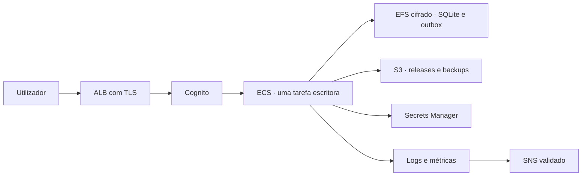
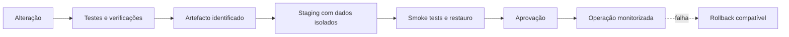

# Operações, monitoring e deployment

Estado revisto em 25 de outubro de 2026. O sistema funciona localmente no
SageMaker Code Editor; ainda não existe um deployment de produção aprovado.
Este documento separa o que está implementado das decisões ainda abertas.

## Destino escolhido para esta entrega

Em 28 de outubro de 2026, o utilizador confirmou execução no SageMaker Code
Editor, em `eu-west-1`, com descoberta dinâmica do Space e uso do workspace atual
por defeito. Esta decisão não aprova um novo hosting ECS/ALB nem exige domínio
próprio. As stacks cloud existentes permanecem disponíveis, mas a sua existência
não comprova publicação. A entrega inclui também Leads/concierge e Backoffice;
os seus recursos e permissões AWS devem ser verificados separadamente.

A descoberta em `scripts/studio_urls.py` usa metadados do Code Editor e
`sagemaker:DescribeSpace`. Nesse ambiente, uma falha de descoberta interrompe a
resolução: não se reutiliza uma URL guardada de outro workspace. Fora do Code
Editor, `config/studio.local.json` é a alternativa de configuração. O teste de
apresentação usa a mesma descoberta do servidor e dos launchers.

## Mapa de aceitação da entrega completa

| Componente | Execução e acesso | Critério de aceitação |
| --- | --- | --- |
| Portal DMC | Code Editor, proxy do Space, porta 3001 | Guardar/reabrir, aprovar, TXT/PDF e Lixo sem alterar histórico |
| Agente | Subprocesso do portal; Bedrock com IAM | Propostas validadas e confirmação humana; falha do fornecedor permite edição manual |
| Tradução | Worker e modelos locais do portal | Idiomas e números preservados; fonte CJK real no PDF mandarim |
| Observatório | Code Editor, porta 8501, e vista nativa no portal | Leitura do warehouse publicado sem escritas |
| Apresentação | Code Editor, porta 3003 | Navegação e link final resolvidos para o Space atual |
| Monitoring | Code Editor, porta 3004, autenticação própria | Login, papéis, incidentes e backups; sonda externa validada separadamente |
| ETL | CLI local, sem endpoint público | Publicação validada/atómica, rollback e fontes preservadas |
| Site e concierge | Pré-visualização no Space, porta 5173; recursos AWS públicos separados | Consentimento, contexto, degradação e endpoints corretos para o ambiente |
| Leads | Rotas servidor do portal e DynamoDB existente | Leitura/gestão autorizadas e isolamento dos dados de ensaio |
| Backoffice | Recursos AWS e invocação IAM, sem interface pública local autónoma | Principais autorizados, conhecimento aprovado e confirmação humana |

O proxy do Studio e a role AWS da sessão não fornecem por si só papéis de
utilizador dentro do portal. No modo SageMaker, a identidade central do portal
permanece desativada; Monitoring tem autenticação própria. A aceitação de acesso
partilhado e a separação de utilizadores continuam a exigir uma decisão explícita.
Não apresentar os testes ALB/Cognito como autenticação ativa no Code Editor.

## Estado operacional atual

| Componente | Execução | Estado persistente |
| --- | --- | --- |
| Portal | Next.js/Node com subprocessos Python, porta 3001 | Catálogo e entregas |
| Apresentação | Servidor estático Python, porta 3003 | Nenhum |
| Monitoring | Servidor Python autenticado, porta 3004 | Contas, eventos, incidentes e backups locais/S3 |
| Assistente BLU | Subprocesso Python iniciado pelo Portal | Auditoria e métricas no histórico operacional |
| Observatório | Streamlit, porta 8501 | Lê o warehouse sem o alterar |
| ETL | Processo invocado sob pedido | Publica o warehouse de forma atómica |

Os comandos locais, portas e configuração do Studio estão no
[README](../README.md). A operação detalhada do painel está no
[guia de Monitoring](../monitoring/README.md) e os procedimentos de incidente no
[runbook](MONITORING_RUNBOOK.md).

O Monitoring recolhe saúde dos serviços, eventos reduzidos do portal e do agente,
estado do warehouse, disco, backups locais/S3 e incidentes deduplicados. Não guarda
prompts, respostas, passwords, tokens ou conteúdo de clientes. Como está na mesma
máquina, não consegue observar a indisponibilidade total do ambiente.

## Recuperação local

`just blu up` é o arranque diário. Mantém processos ativos, inicia apenas os
serviços parados, verifica os quatro endpoints e abre as quatro interfaces. Não
cria checkpoints, não para serviços e não executa recuperação.

`just blu it` é a recuperação integral. Exige autenticação interativa de uma
conta ativa com perfil `admin` do Monitoring e executa:

1. criação e confirmação remota do checkpoint identificado da execução;
2. paragem dos quatro serviços e confirmação das portas livres;
3. recuperação do checkpoint identificado da execução ou fallback para as
   releases do bucket de dados;
4. validação do ambiente e sincronização das dependências bloqueadas;
5. testes Python, Monitoring e portal;
6. build do portal;
7. arranque e verificação dos quatro serviços;
8. abertura das quatro interfaces.

O planeador do agente é validado pela bateria Python e pelas rotas do Portal, sem
uma porta própria. Dados válidos são preservados. O arranque exige as releases S3 de fontes e estado operacional ou
um checkpoint verificado; não existe um warehouse versionado como fallback. O log técnico fica em
`monitoring/runtime/recovery/just-blu-it.log`.

O transporte de fontes, warehouse e estado operacional está em
[Dados e ETL](DATA_PIPELINE.md#origem-etl-em-s3).

Estes comandos não renovam tokens SageMaker, não criam infraestrutura AWS e não
substituem redundância entre regiões/contas, DNS, TLS, identidade ou regras de rede.

### Exceções que exigem intervenção humana

- O `just blu it` exige uma conta ativa do Monitoring com perfil `admin` e lê a
  palavra-passe apenas no terminal interativo. Automação, logs e agentes não devem
  receber, guardar ou contornar essa credencial.
- Num workspace novo, os processos podem estar saudáveis sem que o proxy web do
  SageMaker aceite os URLs `/ports/`. As portas 3001, 3003, 3004 e 8501 devem ser
  adicionadas no painel **Ports** do Code Editor aberto no browser. O painel de
  uma sessão VS Code local/remota cria apenas túneis `127.0.0.1`.
- A execução de 23 de outubro confirmou checkpoint S3, paragem, recuperação e
  reinício até à tarefa 11. A causa da interrupção foi corrigida e os testes de
  navegador passaram isoladamente. A repetição integral exige decisão e login de
  um administrador e fica classificada como operação manual, não como falha de
  implementação ou tarefa de desenvolvimento pendente.
- A role da aplicação não pode consultar ou alterar Versioning, Default
  Encryption, Block Public Access ou lifecycle. Estas verificações pertencem a
  uma sessão administrativa AWS.
- Não se aplica lifecycle sem consultar primeiro as regras existentes, porque a
  escrita substitui a configuração completa. Consultar o procedimento em
  [Retenção dos buckets S3](S3_RETENTION.md#exceções-e-validações-manuais).

Estas limitações não impedem os backups S3 já validados. Delimitam apenas a
administração do bucket e a confirmação final do protocolo autenticado.

## Persistência e recuperação

O S3 protege separadamente:

- releases de fontes Excel/PDF e suplementos;
- releases operacionais com catálogo, histórico, versões, PDFs e filas;
- releases validadas do warehouse;
- checkpoints integrais no bucket de backups;
- contas e evidência operacional em `monitoring/runtime/`.

O Git não é backup destes dados. O backup local do Monitoring verifica hashes,
integridade SQLite e um restauro isolado, mas continua sujeito à falha da mesma
máquina. Reverter código não implica reverter dados; alterações de esquema exigem
compatibilidade e plano próprios.

O procedimento de recuperação integral para os processos, recupera o estado,
reconstrói o ETL e materializa uma cache em `/tmp/blu-runtime-<uid>`. `uv sync`,
`npm ci` e o build recompõem dependências e artefactos efémeros. Os checkpoints
ficam fora do projeto em `BLU_BACKUP_DIR` e no bucket de backups.

Cada checkpoint tem data, hora, identificador aleatório, versão de esquema,
estado e inventário por recurso. A publicação é atómica e só ocorre depois da
verificação de hashes e SQLite. Um checkpoint corrompido é registado em
`monitoring/runtime/recovery/checkpoint-events.jsonl` e o arranque procura uma
versão válida anterior. O restauro nunca substitui um ficheiro existente.
Credenciais, sessões, tokens e dados privados do editor são excluídos.

Quando `BLU_BACKUP_S3_BUCKET` está definido, a mesma operação conserva a cópia
local e publica também um arquivo cifrado no bucket existente, usando as
credenciais IAM normais do ambiente. Não existem chaves AWS no projeto. Os
objetos são imutáveis e organizados por ambiente, tipo e data. O upload e o
download confirmam tamanho, SHA-256, identificador e manifesto; se não houver um
checkpoint local válido, o restauro procura a cópia S3 válida mais recente.

```bash
export BLU_BACKUP_S3_BUCKET=nome-do-bucket-existente
export BLU_ENVIRONMENT=staging
export BLU_BACKUP_S3_PREFIX=blu-backups
# Opcional; sem esta variável é usada encriptação S3 AES-256.
export BLU_BACKUP_S3_KMS_KEY_ID=alias/chave-existente
python3 -B -m monitoring.checkpoint create --remote-required
```

Não existe eliminação remota automática. A retenção deve ser aprovada e aplicada
como lifecycle policy do bucket. O estado técnico do último upload/download, das
bases SQLite e das filas pendentes aparece no cartão de backup do Monitoring.
O papel IAM precisa apenas de `s3:ListBucket`, `s3:GetObject` e `s3:PutObject` no
prefixo configurado; com KMS, acrescentar as permissões da chave já existente.

Restauro manual de uma versão, limitado a ficheiros ausentes:

```bash
BLU_BACKUP_DIR=/caminho/externo python3 -B -m monitoring.checkpoint \
  restore-missing --backup-id IDENTIFICADOR
```

O restauro republica o estado recuperado como uma nova release operacional ativa.
É repetível: chaves idempotentes impedem revisões duplicadas e os JSON pendentes
só desaparecem depois da confirmação SQL e S3. Se o checkpoint mais recente estiver
corrompido, o launcher regista o problema e procura uma versão válida anterior.

Na validação de 23 de outubro de 2026, a cache foi reconstruída a partir dos dois
buckets, as bases SQLite e os hashes dos PDFs foram comparados e os serviços
responderam sem dados persistentes no checkout. Uma reconstrução sem checkpoint
local demorou 63,291 segundos neste ambiente; é uma medição, não um objetivo de
RTO. Para operações confirmadas pela API, o RPO observado foi zero. Uma transação
SQL ainda não confirmada no S3 permanece na outbox e pode perder-se se a máquina
desaparecer antes da repetição.

## Sinais e resposta

| Área | Sinais disponíveis ou necessários |
| --- | --- |
| Serviços | Disponibilidade, latência e alterações de estado |
| Portal | Navegação, operações, falhas de API e erros reduzidos |
| Dados | Idade e validação da publicação ETL |
| Persistência | SQLite, filas pendentes, cópias local/S3 e último restauro |
| IA | Chamadas, falhas, latência e tokens quando reportados |
| Incidentes | Abertura, deduplicação, recuperação local e transporte SNS configurável |

Um HTTP 200 não comprova um fluxo completo, acesso ao Bedrock ou validade dos
dados. Os limiares locais são preliminares até existirem objetivos operacionais.
Cada alerta de produção precisará de responsável, canal e ação de recuperação.
O transporte SNS conserva uma fila local, repete falhas com atraso exponencial e
expõe entregas e pendências no painel. O tópico privado, a subscrição confirmada,
o `sns:Publish` limitado ao respetivo ARN e a entrega real foram validados em
25 de outubro de 2026. A ativação continua a ser configuração local por ambiente.

## Base operacional aprovada

Esta é a decisão da Etapa 1, aprovada em 25 de outubro de 2026. Não cria
infraestrutura nem autoriza custos. Mantém uma única instância
escritora, compatível com o SQLite atual, mas retira o ciclo de vida dos processos
da persistência operacional.

| Decisão | Recomendação | Razão |
| --- | --- | --- |
| Região | `eu-west-1` | Mantém dados, buckets, Bedrock e operação na região atual |
| Demonstração | SageMaker atual, sem garantia de disponibilidade | Preserva o ambiente de desenvolvimento já validado |
| Staging e produção | Serviços ECS separados, cada um com uma tarefa ativa | Permite reinício gerido sem fingir que SQLite suporta várias réplicas |
| Entrada web | Application Load Balancer com TLS e rotas por componente | Substitui o proxy temporário `/ports/` por endpoints estáveis |
| Identidade | Um Amazon Cognito User Pool por ambiente | Evita contas distintas no portal e no Monitoring |
| Papéis | `owner`, `admin`, `curator` e `viewer` | Separa infraestrutura, gestão, edição e consulta |
| Segredos | AWS Secrets Manager, injetado apenas no serviço necessário | Evita `.env`, chaves e passwords dentro das imagens |
| Estado operacional | EFS cifrado para SQLite, histórico, outbox e exports | Uma escrita confirmada sobrevive à substituição da tarefa antes do envio S3 |
| Estado permanente | Releases imutáveis no S3 já existente | Conserva recuperação, integridade e histórico fora da tarefa |
| Escala inicial | Uma tarefa escritora; sem escala horizontal automática | Respeita os limites concorrentes comprovados do SQLite |
| Checkpoints | Apenas estado operacional | Fontes e warehouse já têm releases próprias e não devem ser duplicados |
| Rascunhos | Privados por utilizador e viagem, sincronizados no servidor | Permite continuidade entre dispositivos sem misturar trabalho não publicado |

### Identidade e autorização propostas

| Papel | Capacidades principais |
| --- | --- |
| `owner` | Configuração do espaço, administradores, retenção e operações reforçadas |
| `admin` | Utilizadores, catálogo, Monitoring e recuperação operacional |
| `curator` | Briefings, rascunhos, propostas, versões, exports e partilhas autorizadas |
| `viewer` | Consulta de viagens, versões e sinais expressamente partilhados |

Clientes externos não recebem um papel interno. Continuam a usar partilhas
revogáveis, limitadas no tempo e sem acesso ao workspace. O backend aplica o papel
e o ownership; esconder botões no frontend não constitui autorização. O agente
herda sempre o âmbito do utilizador e nunca eleva permissões.

Contas são criadas por convite administrativo, exigem credencial individual e
podem ser desativadas sem apagar auditoria ou versões. A autenticação local do
Monitoring permanece apenas durante a migração e deve ser retirada depois de o
Cognito proteger portal e Monitoring.

### Objetivos aprovados

| Objetivo | Staging | Produção inicial |
| --- | --- | --- |
| Disponibilidade mensal | Melhor esforço | 99,5% |
| RPO de escritas confirmadas | 15 minutos | 5 minutos |
| RTO | 4 horas | 60 minutos |
| Retenção de conversa do agente | 30 dias | 30 dias |
| Auditoria técnica e de alterações | 90 dias | 365 dias |
| Partilhas expiradas | Remoção após 30 dias | Remoção após 30 dias |

O EFS persistente reduz a janela SQLite → S3, mas não substitui releases e
backups. O objetivo final é que uma escrita só seja apresentada como durável
depois do commit no EFS e do registo idempotente na outbox persistente; a publicação
S3 pode ser repetida após reinício. RPO zero só deve ser prometido depois de testes
de falha reais e, se necessário, publicação S3 síncrona no percurso crítico.

### Fluxo proposto



Papéis, rascunhos sincronizados, objetivos, retenção e a tarefa escritora única
foram aprovados. Para esta fase académica, o Grupo 4 assume tanto a
responsabilidade operacional como a responsabilidade de segurança. Antes de
produção, estas responsabilidades devem ser atribuídas a pessoas ou equipas
formais com contacto e substituto.

### Dimensão e estimativa aprovadas

A referência aprovada para staging é de cinco utilizadores internos, uma tarefa
Fargate Linux/x86 com 2 vCPU e 4 GB durante 730 horas/mês, 20 GB em EFS e 10 GB
de logs por mês. O domínio ainda não foi adquirido; a Etapa 3 deve criar um
subdomínio BLU, certificado ACM e DNS antes da exposição do serviço.

Estimativa bruta mensal para `eu-west-1`, sem descontos nem Free Tier:

| Componente | Cálculo | USD/mês |
| --- | --- | ---: |
| Fargate | 2 vCPU + 4 GB, 730 h | 72,08 |
| Application Load Balancer | 730 h | 18,40 |
| Capacidade ALB | referência conservadora de 1 LCU, 730 h | 5,84 |
| EFS Standard | 20 GB | 6,60 |
| Backup EFS | 20 GB de armazenamento quente estimado | 1,00 |
| CloudWatch Logs | 10 GB ingeridos e retidos por um mês | 6,00 |
| IPv4 público | dois endereços do ALB e um da tarefa, 730 h | 10,95 |
| Secrets Manager | um segredo | 0,40 |
| **Total de referência** | antes de impostos e consumos variáveis | **121,27** |

Os preços unitários foram obtidos em 25 de outubro de 2026 nos catálogos públicos
AWS para `eu-west-1`. A AWS cobra Fargate por vCPU e memória, ALB por hora e LCU,
EFS por armazenamento e CloudWatch por ingestão/retenção. As páginas oficiais de
[Fargate](https://aws.amazon.com/fargate/pricing/),
[Elastic Load Balancing](https://aws.amazon.com/elasticloadbalancing/pricing/),
[EFS](https://aws.amazon.com/efs/pricing/),
[CloudWatch](https://aws.amazon.com/cloudwatch/pricing/) e
[IPv4 público](https://aws.amazon.com/vpc/pricing/) descrevem essas dimensões.

Cognito para cinco utilizadores fica dentro do patamar gratuito aplicável ao
acesso direto, mas MFA por SMS pode ter custo próprio. S3, SNS, pedidos API,
transferência, domínio, Bedrock, restaurações e crescimento acima das
hipóteses não integram os 121,27 USD. A estimativa deve ser recalculada no AWS
Pricing Calculator antes do deployment e comparada depois com Cost Explorer.

A stack independente em [infra/CURATION_WORKSPACE.md](../infra/CURATION_WORKSPACE.md)
materializa esta base como CloudFormation: uma tarefa escritora, cinco containers,
EFS retido e cifrado, Cognito, ALB HTTPS, Secrets Manager e permissões limitadas
aos buckets e SNS existentes. A síntese e os testes locais não criam recursos.
Faltam publicar a imagem unificada e criar domínio/subdomínio, certificado e DNS
na Etapa 3. Os responsáveis académicos e a estimativa de referência estão
registados; não constituem autorização para executar `cdk deploy`.

## Deployment ainda por decidir

Antes de escolher plataforma, definir:

- demonstração, staging e produção;
- utilizadores, identidade, papéis e exposição;
- disponibilidade, perda de dados e tempo de recuperação aceitáveis;
- região, orçamento e responsável operacional;
- política de retenção, redundância entre regiões/contas e dados pessoais;
- cadência e aprovação da publicação ETL.

As alternativas em análise são:

| Alternativa | Adequação | Limite principal |
| --- | --- | --- |
| SageMaker atual | Desenvolvimento e demonstração | Sessão, proxy e máquina única |
| VM dedicada | Primeira operação controlada com uma instância escritora | Ponto único de falha e operação da máquina |
| Serviços geridos | Maior disponibilidade futura | Exige redesenhar persistência, concorrência e deployment |

SQLite e ficheiros locais favorecem inicialmente uma única instância escritora.
Escalar horizontalmente exige rever catálogo, bloqueios, versões e armazenamento
dos PDFs. Nenhuma alternativa está aprovada ou instalada como produção.

Em 24 de outubro de 2026, testes com processos Node independentes confirmaram que
`BEGIN IMMEDIATE` e as revisões-base deixam apenas uma edição concorrente avançar
no catálogo e apenas uma versão suceder à mesma versão anterior. O segundo
escritor recebe conflito e não cria duplicados. Esta evidência cobre processos na
mesma máquina e no mesmo SQLite, não várias réplicas ou máquinas.

Os rascunhos permanecem no `localStorage` e são intencionalmente privados ao
navegador. Dois utilizadores não veem nem conciliam o mesmo rascunho. Antes de
uma operação multiutilizador é necessário escolher entre conservar esse modelo
privado ou criar sincronização autenticada com ownership, revisão e resolução de
conflitos; não se deve transformar o catálogo ou o S3 numa segunda fonte de
rascunhos por acidente.

O `Dockerfile.curation` prepara a imagem de curadoria e exclui dados
operacionais. Os quatro serviços cloud (portal, Monitoring, apresentação e
Observatório) partilham os comandos de `config/curation_services.json`.
O agente é um subprocesso do portal; a declaração histórica da porta 8000 na
imagem não corresponde a um serviço HTTP do agente.

A infraestrutura existe em `infra/curation-workspace.mjs`: ECS com uma task
escritora, EFS retido, ALB HTTPS e Cognito. A existência do código e a síntese
local não comprovam deployment nem aceitação em staging/produção.

### Ligação entre curadoria e Leads

A entrega completa inclui também `BluCostaData`, `BluCostaFrontend` e
`BluCostaBackoffice`, definidos em `infra/aws-split-app.mjs`. O portal consulta
as tabelas existentes pelo servidor e aplica a identidade ALB/Cognito no modo
cloud; não existe aqui uma API Cognito autónoma de Leads.

Antes de sintetizar a stack de curadoria para a entrega completa, definir em
conjunto `BLU_CONVERSATION_TABLE` e `BLU_INTELLIGENCE_TABLE` com os valores dos
outputs `ConversationTableName` e `CustomerIntelligenceTableName` da stack Data
no ambiente-alvo. Usar a mesma conta e região da curadoria. Não inferir nomes nem
reutilizar tabelas de desenvolvimento em produção.

A stack injeta os dois nomes apenas no container do portal e permite à task
`dynamodb:Query` nessas tabelas e no `FollowUpIndex` da inteligência, além de
`dynamodb:UpdateItem` apenas na tabela de inteligência. O papel IAM da task é
partilhado pelos containers: esta configuração não constitui isolamento IAM por
container. Não concede Scan, PutItem, DeleteItem ou criação de tabelas.

Configuração parcial ou nomes inválidos impedem a síntese. Sem ambos os nomes,
o deployment de curadoria isolada continua possível, mas Leads fica indisponível;
esta opção não satisfaz o âmbito completo aprovado. Antes da promoção, confirmar
no ambiente real 401/403, leitura e gestão por papel autorizado, conectividade e
isolamento dos dados. Os testes de template não substituem essa aceitação.

## Fluxo de entrega pretendido



Código, publicação ETL e migrações de dados têm ciclos distintos. O staging deve
usar catálogo, warehouse e exports próprios. A mesma entrega testada deve ser
promovida sem incluir segredos ou dados operacionais na imagem.

## Pendências para produção

A fonte de verdade das tarefas abertas é a secção
[Pendências de monitoring](../PLAN.md#pendências-de-monitoring). Neste momento
faltam:

- sonda executada fora da máquina;
- limiares e escalamento finais associados aos responsáveis de produção;
- decisão de hosting, identidade central, CI do portal, staging e rollback.

Não considerar o monitoring completo nem o deployment pronto enquanto estes
pontos não tiverem implementação e evidência de validação.
