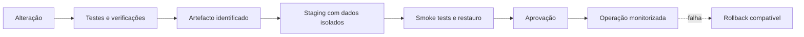

# Operações, monitoring e deployment

Estado revisto em 20 de outubro de 2026. O sistema funciona localmente no
SageMaker Code Editor; ainda não existe um deployment de produção aprovado.
Este documento separa o que está implementado das decisões ainda abertas.

## Estado operacional atual

| Componente | Execução | Estado persistente |
| --- | --- | --- |
| Portal | Next.js/Node com subprocessos Python, porta 3001 | Catálogo e entregas |
| Apresentação | Servidor estático Python, porta 3003 | Nenhum |
| Monitoring | Servidor Python autenticado, porta 3004 | Contas, eventos, incidentes e backups locais |
| Agente | FastAPI opcional, porta 8000 | Logs operacionais reduzidos |
| Observatório | Streamlit, porta 8501 | Lê o warehouse sem o alterar |
| ETL | Processo invocado sob pedido | Publica o warehouse de forma atómica |

Os comandos locais, portas e configuração do Studio estão no
[README](../README.md). A operação detalhada do painel está no
[guia de Monitoring](../monitoring/README.md) e os procedimentos de incidente no
[runbook](MONITORING_RUNBOOK.md).

O Monitoring recolhe saúde dos serviços, eventos reduzidos do portal e do agente,
estado do warehouse, disco, backups locais e incidentes deduplicados. Não guarda
prompts, respostas, passwords, tokens ou conteúdo de clientes. Como está na mesma
máquina, não consegue observar a indisponibilidade total do ambiente.

## Recuperação local

`just blu up` é o arranque diário. Mantém processos ativos, inicia apenas os
serviços parados, verifica os cinco endpoints e abre as quatro interfaces.

`just blu it` é a recuperação integral. Exige autenticação interativa de uma
conta ativa com perfil `admin` do Monitoring e executa:

1. paragem dos cinco serviços e confirmação das portas livres;
2. validação do ambiente e sincronização das dependências bloqueadas;
3. validação ou recuperação seletiva dos dados;
4. testes Python, Monitoring e portal;
5. build do portal;
6. arranque e verificação dos cinco serviços;
7. abertura das quatro interfaces.

O agente na porta 8000 é validado sem abrir um separador. Dados válidos são
preservados; conjuntos ausentes ou inválidos só podem ser recuperados a partir de
um backup verificado. O log técnico fica em
`monitoring/runtime/recovery/just-blu-it.log`.

Estes comandos não renovam tokens SageMaker, não criam infraestrutura AWS e não
substituem backup externo, DNS, TLS, identidade ou regras de rede.

## Persistência e recuperação

Proteger separadamente:

- fontes Excel/PDF e suplementos em `data/`;
- catálogo operacional em `data/portal/catalog.sqlite`;
- entrega publicada em `warehouse/`;
- versões e PDFs em `exports/itineraries/`;
- contas e evidência operacional em `monitoring/runtime/`.

O Git não é backup destes dados. O backup local do Monitoring verifica hashes,
integridade SQLite e um restauro isolado, mas continua sujeito à falha da mesma
máquina. Reverter código não implica reverter dados; alterações de esquema exigem
compatibilidade e plano próprios.

## Sinais e resposta

| Área | Sinais disponíveis ou necessários |
| --- | --- |
| Serviços | Disponibilidade, latência e alterações de estado |
| Portal | Navegação, operações, falhas de API e erros reduzidos |
| Dados | Idade e validação da publicação ETL |
| Persistência | Espaço livre, backups e evidência do último restauro |
| IA | Chamadas, falhas, latência e tokens quando reportados |
| Incidentes | Abertura, deduplicação e recuperação local |

Um HTTP 200 não comprova um fluxo completo, acesso ao Bedrock ou validade dos
dados. Os limiares locais são preliminares até existirem objetivos operacionais.
Cada alerta de produção precisará de responsável, canal e ação de recuperação.

## Deployment ainda por decidir

Antes de escolher plataforma, definir:

- demonstração, staging e produção;
- utilizadores, identidade, papéis e exposição;
- disponibilidade, perda de dados e tempo de recuperação aceitáveis;
- região, orçamento e responsável operacional;
- política de retenção, backups externos e dados pessoais;
- cadência e aprovação da publicação ETL.

As alternativas em análise são:

| Alternativa | Adequação | Limite principal |
| --- | --- | --- |
| SageMaker atual | Desenvolvimento e demonstração | Sessão, proxy e máquina única |
| VM dedicada | Primeira operação controlada com uma instância escritora | Ponto único de falha e operação da máquina |
| Serviços geridos | Maior disponibilidade futura | Exige redesenhar persistência, concorrência e deployment |

SQLite e ficheiros locais favorecem inicialmente uma única instância escritora.
Escalar horizontalmente exige rever catálogo, bloqueios, versões e armazenamento
dos PDFs. Nenhuma alternativa está aprovada ou instalada como produção.

O `Dockerfile.portal` cobre o portal Node, mas não representa uma imagem completa
do sistema Python, dados persistentes e serviços auxiliares. O
[guia AWS do portal](AWS_PORTAL_TESTING.md) é uma referência de teste para uma
arquitetura com load balancer e CloudFront, não prova que essa infraestrutura
exista.

## Fluxo de entrega pretendido

Código, publicação ETL e migrações de dados têm ciclos distintos. O staging deve
usar catálogo, warehouse e exports próprios. A mesma entrega testada deve ser
promovida sem incluir segredos ou dados operacionais na imagem.

## Pendências para produção

A fonte de verdade das tarefas abertas é a secção
[Pendências de monitoring](../PLAN.md#pendências-de-monitoring). Neste momento
faltam:

- destino externo cifrado para backups;
- sonda executada fora da máquina;
- notificações externas com canal, responsáveis, limiares e deduplicação;
- decisão de hosting, identidade central, CI do portal, staging e rollback.

Não considerar o monitoring completo nem o deployment pronto enquanto estes
pontos não tiverem implementação e evidência de validação.
