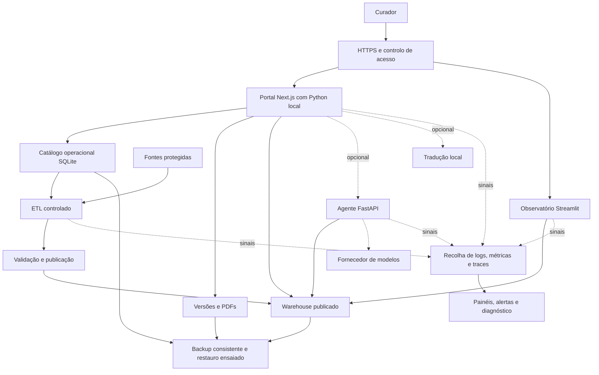
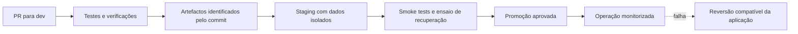

# Monitoring e deployment do sistema BLU

Proposta inicial de 2026-10-19. Este documento descreve trabalho planeado,
não infraestrutura já instalada. Complementa a [arquitetura](ARCHITECTURE.md),
as [operações dos dados](DATA_PIPELINE.md) e o
[guia de teste AWS do portal](AWS_PORTAL_TESTING.md).

## Estado confirmado no código

| Componente | Execução atual | Aspeto a resolver |
| --- | --- | --- |
| Portal | Next.js/Node, com subprocessos Python | Empacotar ambos os runtimes e dependências; verificar prontidão |
| Catálogo | SQLite operacional em `data/portal/` | Persistência, concorrência, backup e restauro |
| Warehouse | Publicação ETL validada e troca com recuperação | Monitorizar validade, versão publicada e falhas de publicação |
| Entregas | Versões e PDFs em `exports/itineraries/` | Preservar bytes, hashes e relações entre versões |
| Observatório | Streamlit, leitura do warehouse | Saúde do processo e disponibilidade da entrega |
| Agente opcional | FastAPI e ferramentas/modelos configuráveis | Saúde atual não verifica catálogo, credenciais nem modelo |
| Tradução opcional | Worker local e modelos instalados | Distinguir instalação ausente, falha e operação disponível |
| Apresentação | Servidor estático independente | Manter separada dos serviços operacionais |

Evidência: `Dockerfile.portal`, `dmc-workspace/src/lib/python-portal.ts`,
`src/blu_ai/api/server.py`, scripts de arranque e workflows existentes.
O Dockerfile instala Node e dependências npm, mas não instala Python nem as
dependências Python do portal. Não constitui ainda uma entrega completa
validada do sistema. A imagem copia o contexto do repositório; rever também
a inclusão de dados e ferramentas locais antes de construir ou publicar.

Existem workflows de dados e documentação. Não existe neste checkout uma
pipeline de CI do portal nem publicação automática do sistema completo.
O acesso pelo SageMaker Studio não substitui autenticação e autorização da
aplicação. O guia AWS existente cobre sobretudo o teste do portal e dos assets.

## Sequência proposta

1. **Definir o alvo.** Distinguir demonstração de produção; acordar quem usa,
   quem opera, dados autorizados, orçamento e disponibilidade esperada.
2. **Tornar a entrega reproduzível.** Validar versões Node/Python, dependências,
   permissões, configurações e arranque sem depender do HOME do programador.
   Serviços opcionais devem continuar opcionais.
3. **Proteger o estado.** Separar aplicação substituível de dados persistentes.
   Começar por uma única instância escritora do catálogo; não aumentar réplicas
   sem validar os contratos de armazenamento, bloqueio e versões.
4. **Observar falhas úteis.** Implementar saúde, logs e métricas antes de
   estabelecer alertas. Testar indisponibilidade de dependências com mocks.
5. **Automatizar a entrega.** Verificações em PR, artefacto identificado pelo
   commit, staging e promoção controlada após aprovação aplicável.
6. **Ensaiar recuperação.** Restaurar backup e reverter uma entrega em ambiente
   isolado; só depois definir a rotina operacional.

## O que monitorizar

| Área | Sinais propostos |
| --- | --- |
| Aplicação | Disponibilidade, erros, latência por rota e falhas dos subprocessos |
| Dados | Último ETL bem-sucedido, idade da publicação, validação e revisão publicada |
| Persistência | Espaço livre, falhas de escrita, bloqueios SQLite e conflitos de versão |
| Backups | Última cópia concluída e último restauro comprovado |
| IA opcional | Latência, timeouts, erros, fallback e consumo quando fornecido pelo serviço |
| Dependências | Falhas de meteorologia, percursos e tradução, separadas da saúde do portal |

Distinguir processo vivo, aplicação pronta para trabalhar e dependência
opcional degradada. As sondas de saúde não devem escrever dados nem chamar
modelos pagos. Uma página HTTP 200, por si só, não comprova o fluxo de curadoria.

Propor logs estruturados com identificador do pedido, componente, duração,
resultado e versão da aplicação/publicação. Excluir prompts completos, dados
de clientes, contactos, PDFs, credenciais e tokens. Definir retenção e acesso.
As métricas não devem usar identificadores pessoais como etiquetas.

Os limiares de alertas ficam pendentes de medições e objetivos acordados.
Cada alerta deve ter responsável, ação de diagnóstico e instrução de recuperação.

## Persistência e recuperação

Preservar fontes, catálogo operacional, warehouse publicado e entregas
autoritativas como conjuntos com responsabilidades distintas. O Git não é
backup do catálogo nem dos PDFs. Rascunhos no navegador não passam
a estar protegidos por um backup do servidor.

Começar pelo procedimento existente: parar portal e ETL para obter uma cópia
consistente do catálogo. Definir uma janela e um conjunto de recuperação
compatível com versões e publicação. Validar o restauro em diretório isolado,
sem substituir os dados operacionais durante o ensaio.

Reverter a aplicação não implica reverter dados. Qualquer alteração de esquema
exige compatibilidade e plano próprios; preservar revisões, snapshots e PDFs.

## Decisões por fechar

- Ambiente inicial: demonstração, staging ou produção.
- Plataforma de execução e serviços que precisam de estar sempre ligados.
- Utilizadores, autenticação, papéis e limites de exposição.
- Objetivos de disponibilidade, perda de dados tolerável e tempo de recuperação.
- Orçamento, responsável operacional e canal de alertas.
- Cadência do ETL e aprovação para publicar novas revisões.
- Política de backups, retenção, restauro e dados pessoais.

Não escolher a plataforma apenas pela interface do portal: ela tem de suportar
os subprocessos Python e o estado persistente, além dos serviços opcionais.

## Desenho lógico comum às alternativas

Proposta independente do fornecedor. As caixas representam responsabilidades;
não obrigam a criar um microserviço por caixa. Autenticação e observabilidade
ainda têm de ser implementadas e validadas.

O ETL lê o catálogo aprovado; não o modifica. A publicação substitui uma
entrega completa depois da validação. A leitura do warehouse pelo agente
reutiliza os contratos existentes. Os acessos externos de meteorologia e
percursos mantêm timeouts e fallback, mas precisam de sinais de degradação.

## Comparação de execução e persistência

Avaliação qualitativa para este repositório, não um orçamento ou benchmark.
Nenhuma alternativa foi selecionada ou instalada.

| Critério | A — SageMaker atual | B — VM dedicada | C — Serviços geridos separados |
| --- | --- | --- | --- |
| Objetivo | Desenvolvimento e demonstração | Primeira operação controlada | Evolução para maior disponibilidade e escala |
| Exemplo | Processos no Studio | EC2 com containers ou supervisor | ECS/Fargate, com persistência redesenhada |
| Node e Python | Ambiente já preparado, mas dependente do utilizador | Imagem reproduzível a preparar | Imagens reproduzíveis por responsabilidade |
| Estado atual em ficheiros | Conserva o desenho atual | Pode conservar SQLite e ficheiros num volume de dados | Precisa de resolver estado partilhado e concorrência |
| Escala do portal | Uma execução | Uma instância escritora inicial | Réplicas só após resolver persistência e contratos |
| Recuperação | Dependente do ambiente e de procedimentos manuais | Restauro e substituição da VM a ensaiar | Recuperação por serviço e armazenamento a desenhar |
| Operação | Pouca alteração inicial; acoplada ao desenvolvimento | Sistema operativo, atualizações e capacidade sob gestão da equipa | Mais configuração de rede, identidade e serviços |
| Limitação central | Sessão e proxy do Studio fazem parte do acesso | Ponto único de falha no desenho inicial | Maior alteração e esforço de integração |

Na alternativa B, um volume EBS é uma opção de armazenamento persistente
para EC2; ciclo de vida, cifragem e restauro devem ser definidos. Persistência
não significa alta disponibilidade nem backup. Ver
[armazenamento EBS](https://docs.aws.amazon.com/AWSEC2/latest/UserGuide/storage_ebs.html).

Na alternativa C, ECS disponibiliza várias opções de volumes, incluindo EFS.
Isso não valida automaticamente SQLite sobre armazenamento de rede: a própria
documentação SQLite descreve limitações de bloqueio e fiabilidade. Ver
[volumes ECS](https://docs.aws.amazon.com/AmazonECS/latest/developerguide/using_data_volumes.html)
e [SQLite em rede](https://www.sqlite.org/useovernet.html).

Uma evolução C poderá exigir uma base transacional cliente/servidor e
armazenamento de objetos para entregas. É uma migração futura a avaliar,
sem criar agora outro catálogo ou persistência paralela. Tem de preservar
transações, conflitos, revisões, hashes, caminhos e bytes PDF. S3 não substitui
diretamente as operações de ficheiros e SQLite existentes.

Serviços de containers sem estado também não resolvem essa dependência por si
só. Por exemplo, o App Runner documenta um sistema de ficheiros efémero; esta
é uma restrição de arquitetura, não uma proposta de adoção. Ver
[contrato de execução](https://docs.aws.amazon.com/apprunner/latest/dg/develop.html).

A hipótese inicial que proponho comparar com mais detalhe é B: altera menos
os contratos atuais e permite ensaiar operação fora do Studio. Só faz sentido
se forem aceitáveis uma instância escritora e uma janela de recuperação.
Se houver um requisito de continuidade durante falhas de máquina, precisamos
de aprofundar C antes de tomar uma decisão.

## Comparação de monitoring

Separar três decisões: que sinais produzir, como transportá-los e onde
armazenar/consultar/alertar. OpenTelemetry cobre recolha e exportação de sinais;
não é, por si só, o sistema de armazenamento e painéis. Ver
[sinais OpenTelemetry](https://opentelemetry.io/docs/concepts/signals/).

| Opção | Vantagem para o BLU | Compromisso |
| --- | --- | --- |
| CloudWatch, com instrumentação compatível | Integração com operação AWS e possibilidade de métricas e traces correlacionados | Configuração, retenção, permissões e consumo a controlar |
| Prometheus com painéis e backends de logs/traces separados | Controlo da stack e portabilidade | Mais componentes para instalar, proteger, atualizar e recuperar |
| Serviço gerido de observabilidade compatível | Reduz operação dos backends | Custo, tratamento de dados e dependência contratual a avaliar |

O CloudWatch documenta integração com OpenTelemetry em EC2/ECS; é necessário
confirmar suporte e instrumentação para cada runtime e para os subprocessos
Python. Ver [configurações suportadas](https://docs.aws.amazon.com/AmazonCloudWatch/latest/monitoring/Getting-Started-App-Signals.html).
Prometheus armazena séries temporais de métricas e não substitui um backend
de logs. Ver [âmbito](https://prometheus.io/docs/introduction/faq/).

A proposta inicial é comparar CloudWatch com uma stack aberta, mantendo um
contrato de sinais independente do backend. Começar por logs estruturados,
saúde, latência, erros e qualidade/publicação dos dados; acrescentar traces
quando ajudarem a localizar falhas entre Node, Python e serviços opcionais.
Não assumir propagação automática de contexto através de stdin/stdout.

## Fluxo de deployment a desenhar

Construir uma vez e promover o mesmo artefacto. Os dados e segredos de operação
não entram na imagem. O staging tem catálogo, exports e warehouse próprios;
os testes de publicação não usam caminhos operacionais.

Definir separadamente entrega de código, publicação ETL e eventual migração
de esquema. No desenho B com SQLite, evitar duas versões do portal a escrever
simultaneamente durante a troca; uma breve manutenção poderá ser necessária.
Não prometer deployment sem interrupção antes de validar esse contrato.

### Recuperação operacional única

O comando `just blu it` materializa o fluxo local de reconstrução: dependências,
validação ou restauro seletivo, testes, build, arranque e sondas finais. Dados válidos
são preservados; apenas conjuntos ausentes ou inválidos são recuperados do último
backup verificado. Logs e PID ficam no runtime privado do monitoring.

Antes de qualquer alteração, o comando solicita credenciais de monitoring através
de um terminal interativo e confirma que pertencem a uma conta ativa com perfil
`admin`. Não aceita palavras-passe em argumentos, variáveis de ambiente ou pipes. Sem
credenciais locais, é necessário recuperar primeiro uma conta com
`python -B -m monitoring.setup`.

A tarefa 0 cria uma janela de manutenção explícita: termina portal, apresentação,
monitoring, agente e Observatório, liberta as cinco portas e confirma que nenhuma
aceita ligações. As restantes tarefas só avançam depois dessa confirmação; os serviços
voltam a arrancar em conjunto após testes e build.

As bibliotecas Linux necessárias aos testes Chromium são verificadas na preparação do
portal e extraídas, sem privilégios, para `monitoring/runtime/browser-libs`. Esta cache
privada persiste entre sessões; a recuperação não depende de ficheiros em `/tmp`.

O launcher é instalado por `scripts/install_just_blu_it.sh`. Num deployment, essa
instalação deve fazer parte da criação da máquina ou imagem. O encaminhamento local
das portas está declarado no workspace, mas autenticação SageMaker, DNS, TLS e regras
de rede pertencem à plataforma e não podem ser restaurados pelo processo local.

## Critérios para fechar a escolha

Antes de dimensionar ou estimar custos, recolher utilizadores simultâneos,
horário de utilização, volumes de dados/PDFs, uso de tradução e agente, região,
retenção e tolerância a interrupções. Comparar custo total, incluindo backups,
monitoring, tráfego e trabalho de operação; não apenas a máquina ou container.

O próximo resultado de desenho será uma decisão registada com alternativa
escolhida, motivos, limites e ensaios necessários. Até lá, as opções e a
preferência preliminar acima são hipóteses, não autorização de deployment.

## Primeira implementação local — 2026-10-19

O [BLU Operations](../monitoring/README.md) concretiza uma primeira camada
independente na porta 3004, protegida por login próprio, com cookies de sessão,
expiração, CSRF no logout, verificação de origem e limitação de tentativas.
Credenciais e logs ficam fora do Git e do contexto Docker do portal.

A recolha verifica serviços locais por HTTP, agregados da validação/publicação
do warehouse e ocupação do disco, sem escrever nos dados operacionais nem
chamar modelos. Mantém histórico limitado e logs de sondas com rotação.

Esta implementação inclui eventos reduzidos do portal e do agente, backups locais
verificados, retenção, limpeza de disco e incidentes deduplicados. O warehouse usa
um limiar preliminar de sete dias e o agente continua opcional. Permanecem por
resolver tracing distribuído, destino externo dos backups, sonda fora da máquina e
notificações externas.
O monitor está na mesma máquina dos serviços: falhas da máquina requerem uma
sonda externa futura. O servidor interno não representa uma decisão de
hosting de produção.

### Administração de acessos — 2026-10-19

O monitoring passa a ter uma página própria de administração em `/users`,
exclusiva de administradores. Leitores consultam apenas o painel. A conta
legada conserva as credenciais e é reconhecida como administrador; alterações
são persistidas atomicamente no formato local com várias contas.

Criação, alteração de palavra-passe/perfil/estado e remoção exigem autorização
no servidor e CSRF. A alteração de uma conta revoga as respetivas sessões,
e o último administrador ativo é protegido. A recuperação CLI preserva as
outras contas e deve ser feita com o serviço parado. Ver o
[guia de gestão de utilizadores](../monitoring/README.md).

Credenciais e logs anteriormente versionados são retirados do índice, com
ficheiros locais preservados e verificação estrutural contra nova inclusão.
O histórico não foi reescrito; a palavra-passe inicial deve ser alterada se
ainda estiver em uso. Os procedimentos de resposta estão no
[runbook de monitoring](MONITORING_RUNBOOK.md).
