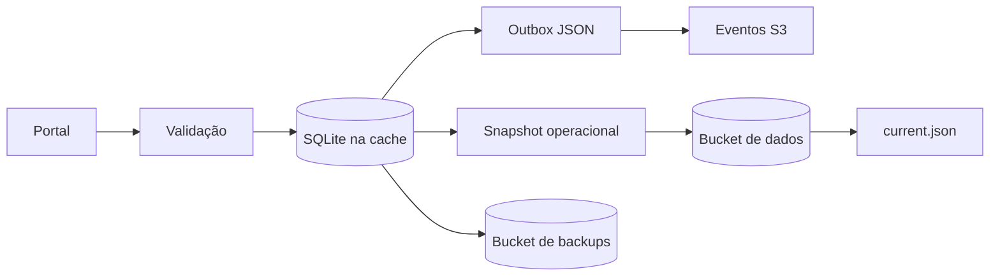
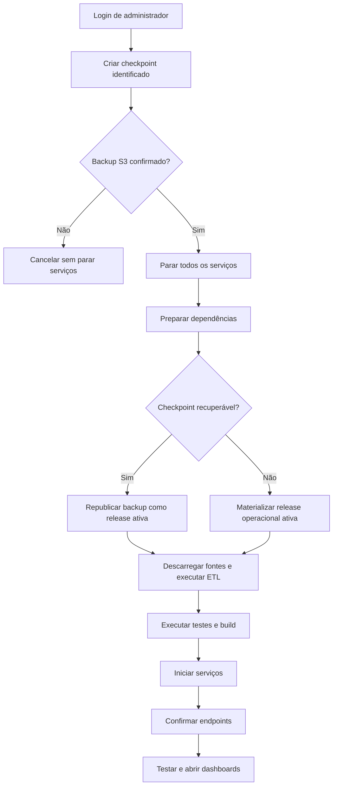
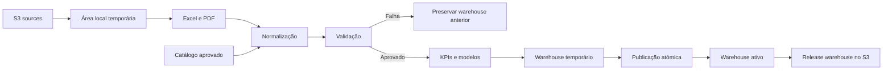

# Persistência, recuperação e ETL

Revisto em 23 de outubro de 2026. Este documento explica o percurso dos dados
operacionais, o protocolo `just blu it` e a publicação do warehouse.

## Estado atual

O S3 é a persistência permanente. O `just blu it` reconstrói em
`/tmp/blu-runtime-<uid>` uma cache efémera, validada e substituída atomicamente.
Portal, Observatório e ETL recebem os caminhos dessa cache através de variáveis
de ambiente. Os dados de origem, o warehouse e o estado operacional deixaram de
ser versionados ou mantidos como persistência no diretório do projeto.

| Área | Persistência | Execução |
| --- | --- | --- |
| Catálogo e histórico | Release operacional S3 | SQLite na cache temporária |
| PDFs | Release operacional S3 | Ficheiros na cache temporária |
| Fila de indisponibilidade | Release operacional e checkpoint S3 | JSON na cache temporária |
| Fontes e warehouse | Releases S3 imutáveis | Áreas temporárias validadas |
| Backups | Bucket de backups | Cópia local exterior ao projeto, quando disponível |

## Criação, alteração e remoção de dados

### Fluxo



### Catálogo

Quando o portal cria ou altera uma atração, restaurante ou experiência:

1. valida e normaliza os campos;
2. calcula um identificador idempotente SHA-256;
3. abre `BLU_DATA_DIR/portal/catalog.sqlite` através do adaptador Python;
4. escreve numa transação SQLite e regista a revisão;
5. verifica a versão-base para impedir edições desatualizadas;
6. regista a operação para sincronização S3;
7. publica uma snapshot operacional no bucket de dados.

Se o SQLite estiver indisponível, a operação validada fica em:

```text
exports/portal-persistence/pending-catalog/
```

Quando a base regressa, a sincronização aplica a operação. A chave determinística
impede que uma repetição crie duas revisões.

### Propostas, itinerários e PDFs

```text
exports/itineraries/history.sqlite
exports/itineraries/<trip-id>/*.pdf
```

A base conserva snapshots, versões parentais, hashes, PDFs originais e
traduzidos, partilhas, operações auditadas do agente e estado do Lixo. Cada
versão é imutável; uma alteração cria uma versão nova.

Se o SQLite estiver indisponível, a versão fica em:

```text
exports/portal-persistence/pending-versions/
```

### Release operacional S3

```text
development/
└── operational/
    ├── releases/
    │   └── <release-id>/
    │       ├── files/
    │       │   ├── data/portal/catalog.sqlite
    │       │   └── exports/itineraries/
    │       │       ├── history.sqlite
    │       │       └── <trip-id>/*.pdf
    │       └── manifest.json
    └── current.json
```

A publicação:

1. cria cópias consistentes das bases SQLite;
2. reúne catálogo, histórico, PDFs e operações pendentes;
3. calcula o SHA-256 de cada ficheiro;
4. envia os objetos com SSE-S3 `AES256`;
5. confirma tamanho e hash no S3;
6. publica o manifesto apenas no fim;
7. atualiza `current.json` para identificar a release ativa.

As publicações ficam serializadas no processo do portal, impedindo que uma
operação mais antiga faça o apontador ativo recuar.

### Eliminações

- **Lixo:** a versão recebe `trashedAt`, sai das listas ativas e continua
  recuperável.
- **Eliminação permanente confirmada:** a versão sai da base ativa e os PDFs
  deixam de integrar a release ativa seguinte.

No bucket de dados, o elemento deixa de existir na release indicada por
`current.json`; as releases anteriores continuam guardadas. No bucket de backups
nada é apagado automaticamente.

### Tolerância a falhas

A transação na cache termina antes da publicação S3. Se o upload falhar,
catálogo e versões conservam uma outbox JSON na própria cache e o checkpoint
seguinte inclui essa fila. A publicação posterior é idempotente e o JSON só é
removido após confirmação remota. O comando de recuperação exige um checkpoint
S3 confirmado antes de parar os serviços.

## Funcionamento do `just blu it`



### Sequência

1. **Autenticação:** exige uma conta ativa do Monitoring com perfil `admin`.
2. **Identificação:** gera um ID como
   `blu-it-20261023T101500Z-a1b2c3d4e5f6`.
3. **Checkpoint:** inclui `data/`, `warehouse/`, `exports/` e o estado permitido
   do Monitoring; exclui passwords, sessões, tokens e credenciais.
4. **Validação:** usa a API de backup SQLite, SHA-256 e um manifesto completo.
5. **Cópia remota:** confirma o checkpoint no bucket de backups. Uma falha
   termina o comando sem parar os serviços.
6. **Ponto zero:** para os cinco serviços e confirma as portas livres.
7. **Preparação:** valida o ambiente e executa `uv sync` e `npm ci`.
8. **Recuperação:** recupera o checkpoint identificado para uma área temporária
   e republica o seu estado operacional como release ativa.
9. **Materialização:** valida `operational/current.json` e promove a release para
   `/tmp/blu-runtime-<uid>` apenas após validar SQLite, hashes e manifestos.
10. **ETL:** descarrega as fontes S3 para uma área temporária, executa o pipeline
    e publica automaticamente o warehouse validado no bucket de dados.
11. **Sincronização:** aplica os JSON pendentes ao SQLite e envia a outbox ao S3.
12. **Validação completa:** executa testes Python, Monitoring, tradução, portal e
    o build Next.js.
13. **Arranque:** inicia os serviços e confirma processos, portas e endpoints.
14. **Testes finais:** executa os cenários de navegador aplicáveis.
15. **Abertura:** abre quatro dashboards; o agente é validado sem abrir separador.

| Serviço | Porta | Ação final |
| --- | ---: | --- |
| Curation Studio | 3001 | Validar e abrir |
| Apresentação | 3003 | Validar e abrir |
| Monitoring | 3004 | Validar e abrir |
| Agente IA | 8000 | Validar |
| Observatório | 8501 | Validar e abrir |

O `just blu up` não executa recuperação. Inicia apenas serviços parados, verifica
os endpoints e abre os dashboards.

## Funcionamento do ETL



### Entradas e transformação

O pipeline utiliza o Excel principal, o dataset estruturado complementar, PDFs
de origem e revisões aprovadas do catálogo. O catálogo é lido em modo read-only;
o ETL não altera propostas nem PDFs.

O processamento descobre fontes, calcula hashes, preserva linhagem, extrai Excel
e PDF, normaliza entidades, integra revisões aprovadas, deteta conflitos e produz
KPIs e modelos analíticos explicáveis.

### Validação e publicação atómica

Antes de publicar, valida estruturas, campos obrigatórios, relações,
identificadores, completude e conflitos. Sem `status: passed` em
`validation_report.json`, preserva o warehouse anterior.

O novo warehouse é construído numa diretoria temporária e só depois substitui o
destino ativo. Uma falha durante a troca repõe a entrega anterior.

```text
warehouse/
├── blu_etl.sqlite
├── manifest.json
├── validation_report.json
├── data_quality_issues.jsonl
├── kpis.json
├── analytical_models.json
└── *.jsonl
```

O Observatório lê `blu_etl.sqlite` e os JSON analíticos. O portal consulta a
oferta publicada, mantendo os dados operacionais separados do warehouse.

### Relação com o S3

O transporte publica releases imutáveis das fontes e apenas warehouses
validados, recupera a release mais recente e confirma tamanho e SHA-256. O ETL
trabalha numa cópia temporária porque o S3 é armazenamento de objetos, não uma
base SQL. O `just blu it` executa este percurso através de `etl.cloud_runtime`.
Para regenerar e publicar manualmente:

```bash
python -B -m etl.cloud_runtime --destination /tmp/blu-runtime-manual
```

## Validação realizada

Em 23 de outubro de 2026 foi reconstruída uma cache real a partir dos dois
buckets, comparada a integridade e as contagens das bases SQLite, confirmados os
hashes dos PDFs e validado o warehouse. Num segundo ensaio, `data/`, `warehouse/`
e `exports/` foram retirados temporariamente do projeto; os quatro dashboards e
a API do catálogo responderam usando apenas a cache. Só depois desse resultado
os dados persistentes foram removidos do Git.

## Implementação relacionada

- `etl/operational_s3.py`: snapshot e materialização operacional.
- `etl/s3_transport.py`: transporte de fontes e warehouse.
- `etl/s3_outbox.py`: confirmação de eventos operacionais.
- `monitoring/checkpoint.py`: criação e restauro de checkpoints.
- `scripts/just_blu_it.sh`: orquestração dos comandos.
- `dmc-workspace/src/lib/operational-s3.ts`: publicação pelo portal.
