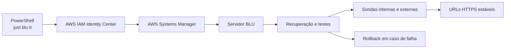

# Deployment remoto a partir de PowerShell

Estado em 2026-10-19: próximo passo planeado, ainda não implementado. Este documento
define o trabalho necessário para executar `just blu it` num computador Windows e
reerguer o sistema BLU na AWS.

## Objetivo

O operador deve conseguir abrir PowerShell, autenticar-se na AWS e executar:

```powershell
just blu it
```

O comando local deve iniciar uma recuperação remota, acompanhar cada tarefa, validar
os serviços através de HTTPS e abrir os endereços finais. Nenhuma chave AWS ou
palavra-passe do monitoring pode ficar no repositório, histórico da shell, argumentos,
variáveis de ambiente ou logs remotos.

## Limite do ambiente atual

O SageMaker Code Editor é o ambiente de desenvolvimento atual. O proxy
`/codeeditor/default/ports/` depende de uma sessão SageMaker válida e não constitui um
endpoint estável de produção. A AWS também não oferece neste ambiente o mesmo controlo
remoto de processos que uma máquina registada no Systems Manager.

A primeira implementação de produção deve usar uma instância EC2 gerida pelo AWS
Systems Manager. Esta solução reutiliza os serviços atuais e adia uma eventual
conversão para contentores até existirem requisitos de escala que a justifiquem.

## Arquitetura proposta



O servidor BLU deve ter Python e Node nas versões suportadas pelo projeto, armazenamento
persistente, agente Systems Manager e unidades `systemd` para portal, apresentação,
monitoring, agente IA e Observatório. As portas internas 3001, 3003, 3004, 8000 e 8501
devem ficar atrás de um reverse proxy ou Application Load Balancer.

## Fases de implementação

### 1. Recolher decisões do ambiente

- Confirmar conta AWS e região; `eu-west-1` é apenas a hipótese atual.
- Definir acesso público, rede privada ou VPN.
- Definir domínio, DNS e nomes dos cinco serviços.
- Recolher utilizadores simultâneos, disponibilidade pretendida e orçamento mensal.
- Confirmar IAM Identity Center e os grupos autorizados a recuperar o sistema.
- Definir onde ficam segredos de fornecedores externos.

### 2. Criar infraestrutura como código

Criar `deployment/` com Terraform ou AWS CDK para provisionar:

- EC2, volume persistente e perfil IAM de privilégio mínimo;
- registo da máquina no Systems Manager;
- S3 cifrado, retenção e política de recuperação para backups;
- rede, grupos de segurança e endpoints privados necessários;
- Application Load Balancer ou reverse proxy;
- certificados no AWS Certificate Manager e registos DNS;
- logs, métricas, alarmes e orçamento AWS.

O deployment deve partir de uma imagem ou bootstrap reproduzível. Não deve depender de
configuração manual acumulada no Code Editor.

### 3. Instalar os serviços

Criar unidades `systemd` separadas para os cinco serviços. Cada unidade deve definir
utilizador sem privilégios, diretório de trabalho, limites de recursos, reinício
controlado, dependências e destino de logs. O catálogo, exports e runtime devem residir
no volume persistente e nunca dentro de um release descartável.

### 4. Adaptar a recuperação remota

Separar o orquestrador em duas entradas:

- launcher PowerShell local, responsável por AWS SSO, autorização e acompanhamento;
- executor remoto, responsável pela tarefa 0, dados, testes, build, arranque e sondas.

O fluxo remoto deve ser:

1. Confirmar identidade e autorização AWS.
2. Confirmar autorização administrativa BLU sem transmitir a palavra-passe em texto.
3. Ativar uma página de manutenção.
4. Parar os cinco serviços e confirmar as portas fechadas.
5. Obter um release imutável e verificar a sua origem.
6. Preparar dependências bloqueadas.
7. Validar ou restaurar dados a partir de backup verificado.
8. Executar testes e construir o portal.
9. Instalar o release e iniciar os serviços.
10. Executar sondas internas e externas.
11. Repor automaticamente o release anterior se a validação falhar.
12. Retirar a manutenção, apresentar URLs e guardar o relatório.

O processo deve manter o feedback por tarefa de 0 a 100%. Detalhes ficam no relatório;
o terminal só apresenta erros quando uma tarefa falha.

### 5. Criar o launcher Windows

Preparar um instalador ou script assinado que configure AWS CLI, `just` e o perfil BLU.
O launcher deve:

- exigir um terminal interativo;
- usar AWS SSO e credenciais temporárias;
- selecionar explicitamente conta, região e ambiente;
- iniciar o comando no Systems Manager;
- transmitir o estado das tarefas para PowerShell;
- validar os endpoints a partir do computador do operador;
- abrir o portal apenas após sucesso completo.

Produção deve exigir uma confirmação inequívoca do ambiente escolhido. O launcher não
deve permitir chaves permanentes nem aceitar segredos na linha de comandos.

### 6. Completar monitoring de produção

Antes da entrada em produção falta:

- configurar notificações externas, destinatários, deduplicação e recuperação;
- instalar uma sonda fora da máquina;
- copiar backups para um destino externo cifrado;
- ensaiar recuperação da máquina completa;
- definir responsáveis, escalamento e tempos de resposta.

A secção **Pendências de monitoring** do `PLAN.md` continua a ser a fonte de verdade.

## Critérios de aceitação

- Um operador autorizado executa `just blu it` em PowerShell sem entrar no servidor.
- Um utilizador sem autorização AWS ou sem perfil administrativo BLU é recusado antes
  de qualquer alteração.
- A tarefa 0 torna os serviços indisponíveis e confirma as portas fechadas.
- O terminal local acompanha todas as tarefas e recebe o erro da tarefa que falhou.
- Dados válidos são preservados e dados inválidos só são repostos por backup verificado.
- Uma falha de build, arranque ou sonda repõe a última versão funcional.
- As cinco URLs HTTPS são verificadas de dentro e de fora da AWS.
- Reboot, perda da instância e restauro a partir de backup são ensaiados.
- Logs e relatórios não contêm segredos, conteúdo de clientes, prompts ou respostas.
- O processo e a infraestrutura podem ser reconstruídos apenas a partir do repositório,
  artefactos autorizados e serviços AWS declarados.

## Informação necessária antes de implementar

- Identificador da conta AWS e confirmação da região.
- Modelo de autenticação AWS e grupos responsáveis.
- Permissões para EC2, IAM, SSM, S3, KMS, ACM, rede, balanceamento e DNS.
- Domínio disponível e política de acesso público ou privado.
- Estimativa de utilizadores, carga, disponibilidade e orçamento.
- Retenção exigida para catálogo, exports, logs e relatórios.
- Destinatários e canal das notificações operacionais.
- Política aprovada para segredos e fornecedores de IA.

Estas decisões não devem ser preenchidas por suposição. A implementação pode preparar
o código e a infraestrutura localmente, mas criar recursos com custos, publicar DNS ou
executar deployment real exige autorização aplicável.
